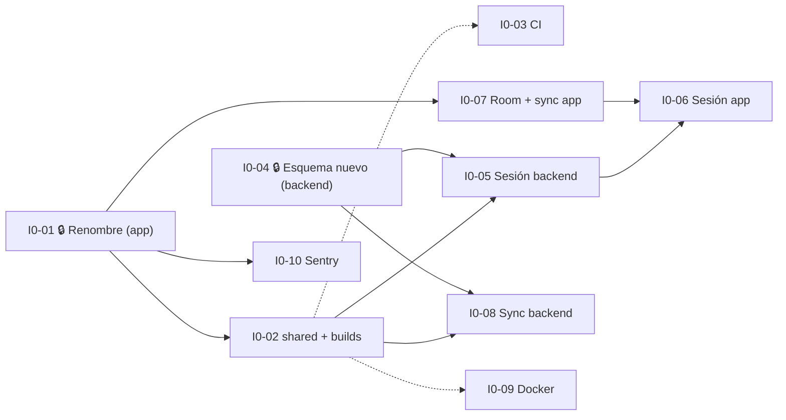

# I0 · Fundaciones técnicas (19/10 – 01/11/2026)

Deja la base técnica sobre la que se construyen I1 a I6 ([ADR-25](../spec-tecnica/50-adr.md)).
No implementa requerimientos funcionales nuevos.

> **⚠️ Antes de tomar una tarea:** verificar que no esté en curso según
> [`CONTRIBUTING.md`](../../CONTRIBUTING.md#antes-de-tomar-una-tarea-personas-y-agentes-de-ia).
> Los agentes de IA informan el resultado antes de crear una rama y se detienen si hay trabajo en
> curso.

## Objetivo de la demo

- La app se llama Pasitos (`com.pasitos.app`) y **conserva la sesión** al cerrarla y abrirla.
- La integración continua corre en cada PR y está en verde.
- El backend corre en Docker con el esquema nuevo.
- El módulo `shared` se usa desde la app y el backend (por ejemplo, la edad formateada del hijo).

## Dependencias y olas

| Ola | Tareas en paralelo | Comentario |
|---|---|---|
| 1 | I0-01, I0-04, I0-03, I0-09 | I0-01 toca solo `app/` y es corta: conviene mergearla el primer día. I0-04 toca solo `backend/` |
| 2 | I0-02, I0-07, I0-10 | Arrancan cuando se mergea I0-01 |
| 3 | I0-05, I0-08 | Arrancan cuando están I0-02 e I0-04 |
| 4 | I0-06 | Cuando están I0-05 e I0-07 |

Las flechas punteadas son dependencias blandas: la tarea puede empezar antes y se completa cuando
se mergea la otra.

---

### I0-01 🔒 · Renombrar la app a Pasitos

| Componente | Tamaño | Depende de | Bloquea | Toca |
|---|---|---|---|---|
| app | S | — | I0-02, I0-07, I0-10 | `app/**`, `README.md` |

**Referencia:** [ADR-12](../spec-tecnica/50-adr.md)

**Qué hacer**
- `applicationId` y `namespace`: `com.ninosano.app` → `com.pasitos.app`.
- Mover los paquetes de Kotlin a `com.pasitos.app` (refactor de Android Studio) y actualizar el
  `AndroidManifest`.
- `rootProject.name = "pasitos"` en `app/settings.gradle.kts`.
- Nombre visible de la app (`app_name`) y textos con "Niño Sano".
- `README.md` de la raíz: título, descripción con la SPEC actual y link a `docs/spec`.

**Criterios de aceptación**
- [ ] No quedan referencias a `ninosano` ni a "Niño Sano" en `app/` (salvo historial de git).
- [ ] La app compila, se instala como "Pasitos" y el flujo actual (login, alta de hijo, medición)
      funciona igual que antes contra el backend local.

**Paralelismo:** 🔒 tarea exclusiva de `app/`: mientras está abierta, nadie toca `app/`. Por eso
conviene hacerla y mergearla el primer día.

---

### I0-02 · Módulo `shared` y builds compuestos

| Componente | Tamaño | Depende de | Bloquea | Toca |
|---|---|---|---|---|
| shared, app, backend | M | I0-01 | I0-05, I0-08 | `shared/**`, `app/settings.gradle.kts`, `app/app/build.gradle.kts`, `backend/settings.gradle.kts`, `backend/build.gradle.kts` |

**Referencia:** [10 · Módulo compartido](../spec-tecnica/10-modulo-compartido.md),
[02 · Estructura](../spec-tecnica/02-estructura-del-repo.md#builds-de-gradle), ADR-01, P-12

**Qué hacer**
- Crear el build `shared/` (Kotlin/JVM, bytecode 17, kotlinx.serialization, JUnit 5), grupo
  `com.pasitos`, paquetes `growth`, `vaccination`, `time` y `api`.
- `includeBuild("../shared")` en app y backend, y dependencia `com.pasitos:shared`.
- Subir `compileOptions` de la app a Java 17.
- Alinear Ktor Server con la versión del cliente (3.6.x) y kotlinx.serialization en los tres builds.
- Primera funcionalidad real en `shared/time`: `formatAge()` según RN-HIJ-04 y RN-HIJ-05, con
  pruebas. Usarla en la app para mostrar la edad del hijo.
- `ErrorResponse` y `ErrorCode` en `shared/api`, usados por el backend.
- Si I0-03 ya está mergeada, agregar el job `shared` a la integración continua.

**Criterios de aceptación**
- [ ] `./gradlew test` pasa en `shared/` con pruebas de `formatAge` (primer mes, menos de 2 años,
      más de 2 años, prematuro con edad corregida).
- [ ] La app y el backend compilan usando `shared`; un cambio en `shared` se refleja en ambos sin
      publicar nada.
- [ ] La app muestra la edad con `formatAge`.

**Paralelismo:** toca los archivos de build de app y backend: coordinar con I0-04 (que también
toca `backend/build.gradle.kts`) para mergear una y después rebasar la otra.

---

### I0-03 · Integración continua y Dependabot

| Componente | Tamaño | Depende de | Bloquea | Toca |
|---|---|---|---|---|
| infra | M | (I0-02, blanda) | — | `.github/workflows/ci.yml`, `.github/dependabot.yml` |

**Referencia:** [31 · Calidad e integración continua](../spec-tecnica/31-calidad-y-ci.md), ADR-14

**Qué hacer**
- Workflow con jobs `backend` (`./gradlew test`), `android` (`assembleDebug testDebugUnitTest
  lint`) y `docs` (verificación de links internos de Markdown), con filtros por ruta y caché de
  Gradle.
- Job `shared`: si `shared/` ya existe al momento del PR, incluirlo; si no, lo agrega I0-02.
- Dependabot semanal para Gradle (app, backend y `shared`) y acciones de GitHub.
- Sección en `CONTRIBUTING.md`: "no se mergea en rojo".

**Criterios de aceptación**
- [ ] Un PR que toca `app/` corre el job `android`; uno que toca solo `docs/` corre solo `docs`.
- [ ] Un link roto en un `.md` hace fallar el job `docs`.
- [ ] El tiempo total con todos los jobs es menor a 15 minutos.

**Paralelismo:** solo toca `.github/`: se puede hacer en paralelo con todo.

---

### I0-04 🔒 · Nueva línea base del esquema y adaptación del backend

| Componente | Tamaño | Depende de | Bloquea | Toca |
|---|---|---|---|---|
| backend | L | — | I0-05, I0-08 | `backend/src/**` |

**Referencia:** [13 · Base de datos](../spec-tecnica/13-base-de-datos.md), ADR-03, ADR-21,
ADR-23, ADR-26

**Qué hacer**
- Borrar `V1__esquema_inicial.sql` y `V2__separar_usuarios_de_personas.sql`.
- Crear la línea base con versión por fecha y hora, solo con lo que necesitan I0 e I1:
  `accounts`, `consents`, `sessions`, `email_tokens`, `children`, `guardianships`,
  `invitations`, `measurements`, `vaccines`, `calendar_versions`, `calendar_doses`,
  `applied_doses`, `other_vaccines`, `access_revocations`, la secuencia `sync_seq` y la función
  `set_sync_version()`. El resto de las tablas las crea cada incremento.
- Flyway con `outOfOrder = true`.
- Reorganizar el backend por dominio en inglés (`auth`, `child`, `measurement`) con la receta
  de [11 · Backend](../spec-tecnica/11-backend.md#1-capas): rutas, servicio, repositorio, tablas.
- **Mantener funcionando los endpoints actuales** (mismas rutas y respuestas) sobre las tablas
  nuevas, para que la app siga andando hasta I0-06 e I1.
- Quitar el cálculo de percentiles guardado (`PercentilCalculator`, columnas de percentil):
  lo reemplaza el motor de `shared` en I2 (ADR-20).
- Base de pruebas de integración con Testcontainers y las primeras pruebas de los endpoints
  actuales.

**Criterios de aceptación**
- [ ] Con una base vacía (`docker compose down -v`), el backend arranca y Flyway crea el esquema.
- [ ] La app actual registra, inicia sesión, da de alta un hijo y carga una medición contra el
      backend nuevo.
- [ ] Hay pruebas de integración que corren contra PostgreSQL real.

**Paralelismo:** 🔒 exclusiva de `backend/src`: las demás tareas de backend dependen de ella.
Avisar a todo el equipo al mergear: **cada uno debe borrar su base local** una vez.

---

### I0-05 · Sesión persistente en el backend

| Componente | Tamaño | Depende de | Bloquea | Toca |
|---|---|---|---|---|
| backend, shared | M | I0-02, I0-04 | I0-06 | `backend/.../auth/**`, `shared/api/auth/**` |

**Referencia:** [11 · Backend, autenticación](../spec-tecnica/11-backend.md#3-autenticación),
ADR-11, RF-CTA-04, RF-CTA-06, RF-CTA-07, RN-CTA-05, RN-CTA-07

**Qué hacer**
- DTOs de autenticación en `shared/api` (primer commit, para destrabar I0-06).
- Endpoints nuevos bajo `/api/v1`: `POST /auth/register`, `POST /auth/login`,
  `POST /auth/refresh`, `POST /auth/logout`, `GET /me`.
- Token de acceso de 15 minutos con `sid`; token de renovación opaco de 30 días con rotación y
  detección de reutilización; validación de `sid` en cada request.
- Bloqueo tras 5 intentos fallidos y límite de requests en `/auth/*` (`RateLimit`).
- Consentimiento de términos en el registro (tabla `consents`).
- Los endpoints viejos de autenticación siguen hasta que I0-06 los reemplace en la app.

**Criterios de aceptación**
- [ ] Pruebas de integración: login correcto e incorrecto, renovación, rotación (el token viejo
      no sirve), reutilización revoca la sesión, logout, bloqueo por intentos, token vencido → 401.
- [ ] La verificación de email todavía no se exige (llega en I1-B1).

**Paralelismo:** en paralelo con I0-08 (dominios distintos). Ambas agregan una línea en
`Application.module()`.

---

### I0-06 · Sesión persistente en la app

| Componente | Tamaño | Depende de | Bloquea | Toca |
|---|---|---|---|---|
| app, backend (limpieza) | M | I0-05, I0-07 | I1-A1, I1-A3 | `app/.../data/auth/**`, `app/.../core/network/**`, `app/.../core/security/**` |

**Referencia:** [15 · App Android, sesión](../spec-tecnica/15-android.md#4-sesión), ADR-11,
RF-CTA-06, RF-CTA-07

**Qué hacer**
- `SessionRepository` con tokens en DataStore cifrados con Tink y el Android Keystore.
- Plugin `Auth` de Ktor Client: renovación automática ante 401 y cierre de sesión si falla.
- Restaurar la sesión al abrir la app.
- `AuthApiRepository` usa los endpoints nuevos de I0-05.
- Cerrar sesión borra tokens y base local (usa la limpieza de I0-07).
- Borrar del backend los endpoints de autenticación viejos.

**Criterios de aceptación**
- [ ] Iniciar sesión, cerrar la app por completo y volver a abrirla: entra sin pedir credenciales.
- [ ] Con el token de acceso vencido, la app lo renueva sola y el usuario no lo nota.
- [ ] Cerrar sesión vuelve al login y no quedan tokens ni datos locales.
- [ ] Verificado en emulador o dispositivo, no solo compilado.

**Paralelismo:** última tarea de I0; puede ir en paralelo con el arranque de I1-B1 a I1-B4.

---

### I0-07 · Base local cifrada y esqueleto de sincronización en la app

| Componente | Tamaño | Depende de | Bloquea | Toca |
|---|---|---|---|---|
| app | M | I0-01 | I0-06, I1-A4, I1-A6, I1-A7 | `app/.../core/database/**`, `app/.../core/sync/**`, `app/.../core/security/**`, `libs.versions.toml` |

**Referencia:** [15 · App Android](../spec-tecnica/15-android.md#3-base-local-cifrada-adr-17),
[14 · Sincronización](../spec-tecnica/14-sincronizacion.md#6-en-la-app), ADR-02, ADR-15, ADR-17

**Qué hacer**
- Room + SQLCipher: `PasitosDatabase` con las tablas de soporte `pending_mutations` y
  `sync_state`.
- Clave de la base: 32 bytes aleatorios cifrados con Tink y el Keystore, guardados en DataStore.
- `SyncWorker` con WorkManager y Hilt: disparos inmediato, periódico (15 minutos) y manual. En
  I0 solo registra la ejecución; la lógica de cambios llega con I0-08 e I1.
- `ArgentinaClock.today()` (ADR-26).
- Función para borrar base y clave (la usa el cierre de sesión).

**Criterios de aceptación**
- [ ] El archivo de la base no se puede abrir con un visor de SQLite sin la clave.
- [ ] El `SyncWorker` se ejecuta al abrir la app y cada 15 minutos con red (visible en Logcat o
      App Inspection).
- [ ] Pruebas de los DAOs de soporte con Room en memoria.

**Paralelismo:** solo toca `core/` de la app: en paralelo con I0-10 y con todo el backend.

---

### I0-08 · Sincronización en el backend

| Componente | Tamaño | Depende de | Bloquea | Toca |
|---|---|---|---|---|
| backend, shared | M | I0-02, I0-04 | I1-B4, I1-B6 | `backend/.../sync/**`, `shared/api/sync/**`, migraciones de triggers |

**Referencia:** [14 · Sincronización](../spec-tecnica/14-sincronizacion.md), ADR-15, ADR-16,
ADR-28

**Qué hacer**
- Triggers `set_sync_version()` en las tablas sincronizables de la línea base.
- DTOs de sincronización en `shared/api` (`SyncChangesResponse`, `SyncPushRequest`, resultados).
- `GET /sync/changes`, `GET /sync/snapshot/{childId}` y `POST /sync/push` **genéricos**: cada
  dominio registra su entidad (lectura por alcance, validación, `UPSERT`, borrado lógico). En I0
  no hay ninguna entidad registrada todavía; I1 registra `children`, `measurements`, etc.
- Alcance del tutor (sus hijos) y `access_revocations`.

**Criterios de aceptación**
- [ ] Pruebas con una entidad de prueba registrada solo en los tests: cursor, paginación de 500,
      lápidas, idempotencia del `UPSERT`, `newChildIds`, `revokedChildIds`, rechazo con código y
      regla.

**Paralelismo:** en paralelo con I0-05.

---

### I0-09 · Imagen Docker del backend y entorno local

| Componente | Tamaño | Depende de | Bloquea | Toca |
|---|---|---|---|---|
| infra | S | (I0-02, blanda) | — | `backend/Dockerfile`, `docker-compose.yml`, `.dockerignore` |

**Referencia:** [30 · Infraestructura](../spec-tecnica/30-infraestructura.md), ADR-05

**Qué hacer**
- `Dockerfile` en dos etapas (JDK 21 para compilar `shared` y `backend`; JRE 21 para ejecutar),
  usuario sin privilegios y `HEALTHCHECK` sobre `/health`.
- `docker-compose.yml`: servicio `mailpit` y servicio `backend` con el perfil `full`.
- Documentar en el README cómo levantar todo.

**Criterios de aceptación**
- [ ] `docker compose --profile full up` levanta base, Mailpit y backend, y `/health` responde.
- [ ] La imagen no contiene secretos ni el archivo `.env`.

**Paralelismo:** no toca código: en paralelo con todo. Si `shared/` todavía no existe, se ajusta
el `Dockerfile` cuando se mergea I0-02.

---

### I0-10 · Registro de errores con Sentry

| Componente | Tamaño | Depende de | Bloquea | Toca |
|---|---|---|---|---|
| app, backend | S | I0-01, P-07 | — | Inicialización de app y backend, `libs.versions.toml`, `backend/build.gradle.kts` |

**Referencia:** [20 · Seguridad, reglas para el código](../spec-tecnica/20-seguridad.md#reglas-para-el-código),
ADR-08

**Qué hacer**
- Sentry en la app y en el backend, región UE, DSN por configuración y entorno
  (`local`, `ci`, `pilot`).
- `sendDefaultPii = false` y filtro que elimina cuerpos, encabezados `Authorization` y
  parámetros de consulta.
- En `local` y `ci` no se envían eventos salvo que se configure el DSN.

**Criterios de aceptación**
- [ ] Un error forzado en debug aparece en Sentry sin email, nombre ni token.
- [ ] Sin DSN configurado, la app y el backend funcionan igual.

**Paralelismo:** cambios chicos en la inicialización; en paralelo con todo.
