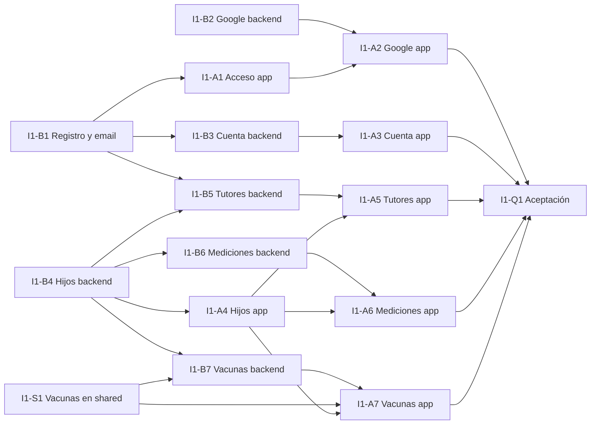

# I1 · Base de tutores (02/11 – 15/11/2026)

Cuentas completas, hijos con varios tutores, mediciones y vacunas, todo con la base local y la
sincronización de I0.

**Requerimientos:** RF-CTA-01 a 07, RF-CTA-09, RF-CTA-11, RF-HIJ-01 a 09, RF-CRE-01 a 03,
RF-CRE-10, RF-VAC-01 a 05, RF-VAC-07 ([SPEC funcional](../spec/00-vision-y-alcance.md#6-plan-de-incrementos)).

> **⚠️ Antes de tomar una tarea:** verificar que no esté en curso según
> [`CONTRIBUTING.md`](../../CONTRIBUTING.md#antes-de-tomar-una-tarea-personas-y-agentes-de-ia).
> Los agentes de IA informan el resultado antes de crear una rama y se detienen si hay trabajo en
> curso.

## Objetivo de la demo

Un tutor se registra, verifica su email, inicia sesión (también con Google), da de alta un hijo
con sus datos de nacimiento, invita a otro tutor que acepta, carga mediciones y vacunas, y el
segundo tutor ve todo en su teléfono.

## Dependencias y olas

| Ola | Tareas en paralelo | Comentario |
|---|---|---|
| 1 | I1-B1, I1-B4, I1-S1, I1-B2 | I1-B2 solo si el proyecto de Google y Firebase ya existe (P-05). Pueden empezar durante los últimos días de I0 |
| 2 | I1-B3, I1-B5, I1-B6, I1-B7, I1-A1, I1-A4 | Las de app arrancan con el contrato de `shared/api` ya mergeado |
| 3 | I1-A2, I1-A3, I1-A5, I1-A6, I1-A7 | Cuatro personas, una pantalla o dominio cada una |
| 4 | I1-Q1 | Cierre del incremento |

**Base de Room durante el desarrollo:** I1-A4, I1-A6 e I1-A7 agregan entidades a
`PasitosDatabase`. Hasta el piloto, la base local se recrea al cambiar su versión (sus datos se
vuelven a descargar del servidor), así que no hace falta coordinar migraciones de Room: si dos
PRs suben la versión, el segundo la vuelve a subir al rebasar.

---

### I1-B1 · Registro con verificación de email y recuperación de contraseña (backend)

| Componente | Tamaño | Depende de | Bloquea | Toca |
|---|---|---|---|---|
| backend, shared | L | I0-05 | I1-B3, I1-B5, I1-A1 | `backend/.../auth/**`, `backend/.../web/**`, `backend/.../mail/**`, plantillas Thymeleaf |

**Requerimientos:** RF-CTA-01 (salvo CA5, que es de I3), RF-CTA-02, RF-CTA-05, RN-CTA-01 a 03,
RN-CTA-06

**Qué hacer**
- Envío de emails por SMTP (Simple Java Mail), plantillas HTML y texto con Thymeleaf; en local,
  Mailpit (ADR-07).
- Registro: validación de contraseña (RN-CTA-01), consentimiento expreso con versión (RN-CTA-02),
  email en minúsculas y único (RN-CTA-03), envío de verificación.
- `POST /auth/email-verification` (reenvío) y `POST /auth/password-reset` con respuesta idéntica
  exista o no la cuenta.
- Páginas `/web/verify-email` y `/web/reset-password` (ADR-27).
- El login exige email verificado: responde un código específico para que la app muestre la
  pantalla de verificación.
- Recuperar la contraseña revoca todas las sesiones.

**Criterios de aceptación**
- [ ] Pruebas de integración para cada CA de RF-CTA-01 (1 a 4), RF-CTA-02 y RF-CTA-05, verificando
      el email recibido en el servidor SMTP de prueba.
- [ ] Los links vencen según RN-CTA-06 y no se pueden usar dos veces.

---

### I1-B2 · Inicio de sesión con Google (backend)

| Componente | Tamaño | Depende de | Bloquea | Toca |
|---|---|---|---|---|
| backend | S | I0-05, P-05 | I1-A2 | `backend/.../auth/google/**` |

**Requerimientos:** RF-CTA-03, RN-CTA-04

**Qué hacer**
- `POST /auth/google`: verificar firma (claves públicas de Google), `aud`, `iss` y vencimiento
  del ID token.
- Primer ingreso: crear la cuenta, pedir términos (la respuesta lo indica).
- Email coincidente con cuenta verificada: asociar `google_subject` e ingresar (RN-CTA-04).

**Criterios de aceptación**
- [ ] Pruebas con tokens firmados por una clave de prueba: válido, vencido, `aud` incorrecto,
      cuenta existente verificada y no verificada.

---

### I1-B3 · Cuenta del usuario (backend)

| Componente | Tamaño | Depende de | Bloquea | Toca |
|---|---|---|---|---|
| backend | M | I1-B1 | I1-A3 | `backend/.../account/**` |

**Requerimientos:** RF-CTA-09 (CA1), RF-CTA-11, RN-CTA-02

**Qué hacer**
- `GET /me` con perfiles, `last_mode` y términos pendientes; `PATCH /me`.
- `POST /me/email-change` con verificación del email nuevo y aviso al anterior
  (`/web/confirm-email-change`).
- `POST /me/password` (pide la actual; revoca las demás sesiones).
- `POST /me/consents` para aceptar una versión nueva de los términos.

**Criterios de aceptación**
- [ ] Pruebas de integración para cada CA de RF-CTA-11.

---

### I1-B4 · Hijos y permisos (backend)

| Componente | Tamaño | Depende de | Bloquea | Toca |
|---|---|---|---|---|
| backend, shared | L | I0-04, I0-08 | I1-B5, I1-B6, I1-B7, I1-A4 | `backend/.../child/**`, `backend/.../guardianship/**`, `backend/.../common/AccessPolicy.kt`, `shared/api/child/**` |

**Requerimientos:** RF-HIJ-01 a 03, RF-HIJ-09, RN-HIJ-01 a 08, RN-HIJ-10, RN-HIJ-11

**Qué hacer**
- `AccessPolicy` con el acceso de tutor (principal y secundario); 404 sin acceso
  ([11 · Backend](../spec-tecnica/11-backend.md#4-autorización)).
- `POST /children` (con declaración de representación en `consents`), `GET`/`PATCH
  /children/{id}`, `GET /children/{id}/deletion-preview`, `DELETE /children/{id}` con las reglas
  de RN-HIJ-08 y el caso "hay otros tutores".
- Registrar `children` y `guardianships` en la sincronización (alcance del tutor).
- Borrar los endpoints viejos de hijos.

**Criterios de aceptación**
- [ ] Pruebas de integración por cada CA de RF-HIJ-01 (1, 3, 4, 5), 02, 03 y 09.
- [ ] Pruebas de matriz de permisos: otro tutor recibe 404; un tutor secundario no puede eliminar
      el perfil para todos.

---

### I1-B5 · Tutores e invitaciones (backend)

| Componente | Tamaño | Depende de | Bloquea | Toca |
|---|---|---|---|---|
| backend | M | I1-B4, I1-B1 | I1-A5 | `backend/.../guardianship/**`, `backend/.../invitation/**` |

**Requerimientos:** RF-HIJ-05 a 08, RN-HIJ-06, RN-HIJ-07

**Qué hacer**
- Invitar por email (con y sin cuenta), aceptar con declaración, rechazar, reenviar.
- Vencimiento a los 15 días calculado al leer (la tarea programada de limpieza llega en I6).
- Quitar tutor, abandonar, transferir el rol principal.
- Notificaciones en el centro de notificaciones: se registran en I6; en I1 alcanza con el email.

**Criterios de aceptación**
- [ ] Pruebas de integración por cada CA de RF-HIJ-05 a 08.
- [ ] Al aceptar, el niño aparece en `newChildIds` del tutor invitado y en su foto completa.
- [ ] Al quitar un tutor, el niño aparece en sus `revokedChildIds`.

---

### I1-B6 · Mediciones por sincronización (backend)

| Componente | Tamaño | Depende de | Bloquea | Toca |
|---|---|---|---|---|
| backend, shared | M | I1-B4 | I1-A6 | `backend/.../measurement/**`, `shared/api/measurement/**` |

**Requerimientos:** RF-CRE-01 (CA2, CA4, CA6), RF-CRE-02, RN-CRE-03 (validación de forma de
medición), RN-CRE-12, ADR-28

**Qué hacer**
- Registrar `MEASUREMENT` en `/sync/push` y `/sync/changes`: validaciones de fecha, al menos un
  valor, rangos absolutos de entrada, una medición por autor y fecha, `outlier_confirmed`.
- Solo el autor edita o borra (borrado lógico).
- Borrar los endpoints viejos de mediciones.
- Las validaciones de rango viven en `shared` para que la app las aplique antes de enviar.

**Criterios de aceptación**
- [ ] Pruebas de integración por cada validación, por autoría y por idempotencia del reenvío.

---

### I1-S1 · Estados de vacunas en `shared` y datos del calendario

| Componente | Tamaño | Depende de | Bloquea | Toca |
|---|---|---|---|---|
| shared, datos | M | I0-02 | I1-B7, I1-A7 | `shared/vaccination/**`, `backend/seed/calendar/**` |

**Requerimientos:** RN-VAC-01, RN-VAC-03, RN-VAC-04, RN-VAC-08, RN-VAC-09

**Qué hacer**
- Llevar la lógica de `DoseStatusResolver` de la app a `shared/vaccination/doseStatuses()` con los
  estados Programada, Próxima, Pendiente, Atrasada y Aplicada, anticipación y tolerancia por dosis,
  y `doseCode` estable.
- Pasar a CSV en `backend/seed/calendar/` el calendario que hoy está en
  `FakeVaccinationRepository`, con `dose_code`, `age_days`, anticipación 7 y tolerancia 30, y
  revisarlo contra el Calendario Nacional vigente.

**Criterios de aceptación**
- [ ] Pruebas de cada estado en sus bordes, dosis aplicada sin fecha y cambio de versión de
      calendario.

**Paralelismo:** no toca app ni backend: se puede hacer desde el primer día de I1 (o antes).

---

### I1-B7 · Vacunación (backend)

| Componente | Tamaño | Depende de | Bloquea | Toca |
|---|---|---|---|---|
| backend, shared | M | I1-B4, I1-S1 | I1-A7 | `backend/.../vaccination/**`, `shared/api/vaccination/**`, tarea `seedReferenceData`, una migración, `backend/seed/calendar/`, `sync/` (dos entidades) y `ChildService.delete` (limpieza al eliminar un niño) |

**Requerimientos:** RF-VAC-01 a 05, RF-VAC-07, RN-VAC-02, RN-VAC-09

**Qué hacer**
- Tarea de Gradle `seedReferenceData` que carga el calendario desde `backend/seed/`.
- `GET /vaccination-calendar` con `ETag`.
- Dosis aplicadas: crear, editar, borrar (solo autor), carga retroactiva; otras vacunas.
- Registrar `applied_doses` y `other_vaccines` en `/sync/changes` (solo lectura).

**Criterios de aceptación**
- [ ] Pruebas de integración por cada CA de RF-VAC-02 a 05.

---

### I1-A1 · Registro, verificación, inicio de sesión y recuperación (app)

| Componente | Tamaño | Depende de | Bloquea | Toca |
|---|---|---|---|---|
| app | M | I0-06, I1-B1 | I1-A2 | `app/.../feature/login/**`, `app/.../feature/register/**`, `app/.../feature/emailverification/**` |

**Requerimientos:** RF-CTA-01, RF-CTA-02, RF-CTA-04, RF-CTA-05, RF-CTA-07

**Qué hacer**
- Registro con casilla de términos no premarcada y validación de contraseña en vivo.
- Pantalla "Verificá tu email" con reenviar y "Ya verifiqué".
- "Olvidé mi contraseña" con el mensaje neutro.
- Mensajes de error de la API (bloqueo, credenciales incorrectas).

**Criterios de aceptación**
- [ ] Cada CA de RF-CTA-01 (1 a 4), 02, 04 y 05 verificado en dispositivo con Mailpit.

---

### I1-A2 · Inicio de sesión con Google (app)

| Componente | Tamaño | Depende de | Bloquea | Toca |
|---|---|---|---|---|
| app | S | I1-B2, I1-A1 | — | `app/.../feature/login/**`, `app/.../data/auth/google/**` |

**Requerimientos:** RF-CTA-03

**Qué hacer:** Credential Manager con `GetGoogleIdOption`; aceptación de términos en el primer
ingreso; manejo de cancelación.

**Criterios de aceptación**
- [ ] CA1 a CA3 de RF-CTA-03 verificados en dispositivo con una cuenta de Google de prueba.

---

### I1-A3 · Perfil y cuenta (app)

| Componente | Tamaño | Depende de | Bloquea | Toca |
|---|---|---|---|---|
| app | S | I1-B3, I0-06 | — | `app/.../feature/profile/**` |

**Requerimientos:** RF-CTA-09 (CA1), RF-CTA-11, RN-CTA-02, RNF-OFF-04 (hora de la última
sincronización)

**Qué hacer:** editar nombre, cambiar email y contraseña, aceptar términos nuevos al ingresar,
cerrar sesión con la advertencia de cambios pendientes, mostrar la última sincronización.

**Criterios de aceptación**
- [ ] Cada CA de RF-CTA-11 y RF-CTA-07 (CA2) verificado en dispositivo.

---

### I1-A4 · Hijos con base local (app)

| Componente | Tamaño | Depende de | Bloquea | Toca |
|---|---|---|---|---|
| app | L | I1-B4, I0-07 | I1-A5, I1-A6, I1-A7 | `app/.../data/child/**`, `app/.../feature/childonboarding/**`, `app/.../feature/childselector/**`, `app/.../feature/childprofile/**`, `app/.../core/sync/**` |

**Requerimientos:** RF-HIJ-01 a 04, RF-HIJ-09, RN-HIJ-01 a 05, RN-HIJ-10, RN-HIJ-11

**Qué hacer**
- El motor que trae los cambios en la app (`core/sync`), con un manejador por entidad que I1-A6 e
  I1-A7 reutilizan ([14 §6.1](../spec-tecnica/14-sincronizacion.md#61-implementación-en-la-app-i1-a4)).
  Enviar la bandeja de salida queda para I1-A6.
- `ChildRepository` lee de Room y se alimenta de la sincronización (`children`, `guardianships`).
- Alta con los campos nuevos: semanas de gestación (con "No lo sé"), medidas al nacer, avatar
  predefinido, declaración de representación.
- Edición con la advertencia de recálculo, alergias y antecedentes, selector de hijo activo
  persistente, eliminación con confirmación por nombre.

**Criterios de aceptación**
- [ ] Cada CA de RF-HIJ-01 (1, 3, 4, 5), 02, 03, 04 y 09 verificado en dispositivo.
- [ ] Un hijo dado de alta en un teléfono aparece en otro teléfono del mismo tutor después de
      sincronizar.

---

### I1-A5 · Tutores (app)

| Componente | Tamaño | Depende de | Bloquea | Toca |
|---|---|---|---|---|
| app | M | I1-B5, I1-A4 | — | `app/.../feature/guardians/**`, `app/.../feature/invitations/**` |

**Requerimientos:** RF-HIJ-05 a 08

**Qué hacer:** pantalla de tutores del niño, invitar, lista de invitaciones recibidas con
aceptar (con declaración) y rechazar, quitar, abandonar y transferir el rol principal. Al
aceptar o perder acceso, la sincronización trae o borra el niño.

**Criterios de aceptación**
- [ ] Cada CA de RF-HIJ-05 a 08 verificado con dos cuentas en dos dispositivos o emuladores.

---

### I1-A6 · Mediciones con base local y bandeja de salida (app)

| Componente | Tamaño | Depende de | Bloquea | Toca |
|---|---|---|---|---|
| app | M | I1-B6, I1-A4 | — | `app/.../data/measurement/**`, `app/.../feature/measurement/**`, `app/.../feature/measurementhistory/**` |

**Requerimientos:** RF-CRE-01 a 03, RF-CRE-10, ADR-28

**Qué hacer**
- Guardar en Room y en `pending_mutations`; envío por `/sync/push`; marca de pendiente y error.
- Formulario con forma de medición sugerida por edad y ayuda (RF-CRE-10); perímetro cefálico solo
  hasta los 5 años; confirmación de valores fuera de rango.
- Historial con autor ("Familia" o profesional) y edad corregida cuando aplica; edición y borrado
  solo de lo propio.
- Percentiles y estado: **no** en I1 (llegan en I2); la pantalla deja el lugar sin datos falsos.

**Criterios de aceptación**
- [ ] Cada CA de RF-CRE-01 (1 a 4, 6), 02 (1, 2), 03 (1, 2) y 10 verificado en dispositivo.
- [ ] Una medición cargada por un tutor aparece en el teléfono del otro tutor.

---

### I1-A7 · Vacunas con base local (app)

| Componente | Tamaño | Depende de | Bloquea | Toca |
|---|---|---|---|---|
| app | L | I1-B7, I1-S1, I1-A4 | — | `app/.../data/vaccination/**`, `app/.../feature/vaccination/**`, `app/.../feature/vaccinedetail/**`, `feature/previousdoses` y `feature/othervaccine` (nuevas), `core/sync` (`ReferenceData`), `PsBadge`, el alta de hijo, Inicio y la navegación |

**Requerimientos:** RF-VAC-01 a 05, RF-VAC-07, RF-HIJ-01 (CA2)

**Qué hacer**
- Calendario desde Room con estados de `shared/vaccination` (reemplaza `DoseStatusResolver` y
  `FakeVaccinationRepository`).
- Registrar, editar y borrar dosis (con conexión), lote recomendado sin insistir.
- Carga retroactiva al dar de alta un hijo y desde "Marcar dosis anteriores".
- Otras vacunas y detalle de vacuna.

**Criterios de aceptación**
- [ ] Cada CA de RF-VAC-01 a 05 y 07 verificado en dispositivo.

---

### I1-Q1 · Aceptación de I1 y demo

| Componente | Tamaño | Depende de | Bloquea | Toca |
|---|---|---|---|---|
| docs | S | Todas las de I1 | Inicio de I2 | `docs/plan/aceptacion/I1.md` |

**Qué hacer**
- Lista de verificación con todos los CA de los RF de I1, ejecutada en un dispositivo real contra
  el backend local con datos ficticios.
- Registrar los hallazgos como issues (bugs a corregir antes de la demo o en I2).
- Guion de la demo según el objetivo de este incremento.

**Criterios de aceptación**
- [ ] Todos los CA de I1 marcados como cumplidos o con su issue abierto.
