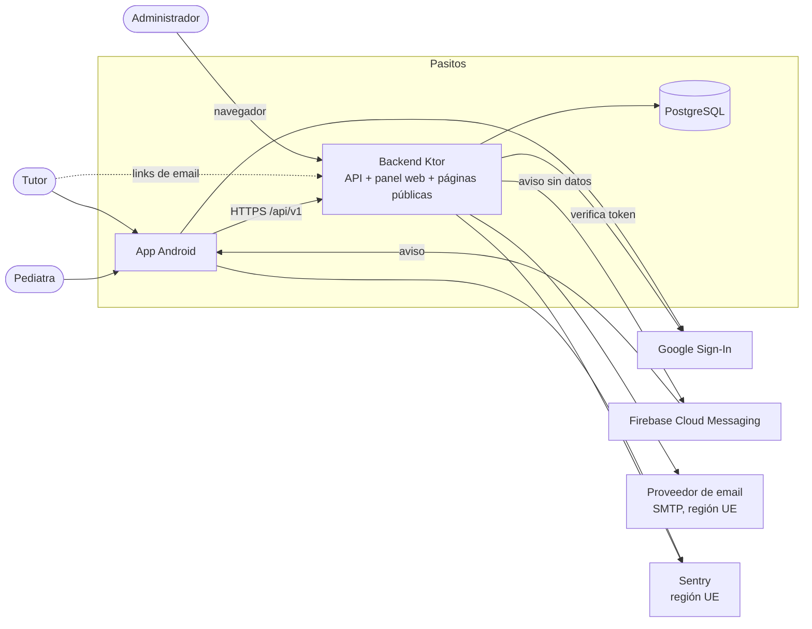
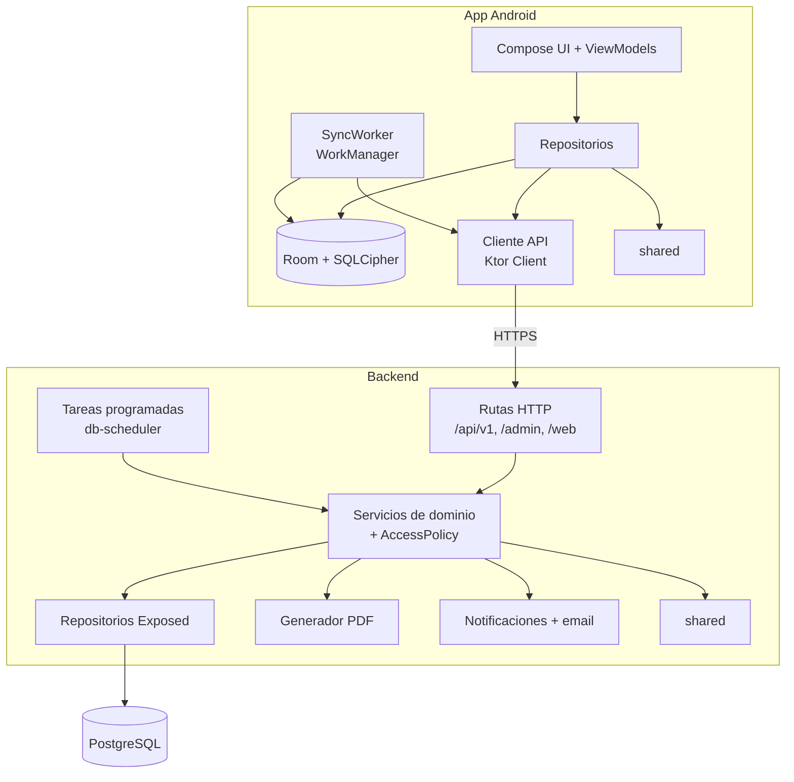

# 00 · Arquitectura

## 1. Contexto

| Componente | Responsabilidad |
|---|---|
| **App Android** | Interfaz para tutores y pediatras. Guarda una copia local cifrada de los datos, calcula percentiles y estados sin conexión y sincroniza con el backend. |
| **Backend** | Única fuente de verdad. Expone la API REST, aplica permisos, calcula, genera PDFs, programa notificaciones, envía emails y sirve el panel de administración y las páginas públicas (verificación de email, recuperación de contraseña). |
| **PostgreSQL** | Persistencia de todos los datos y de las tareas programadas. |
| **Módulo compartido** | Biblioteca Kotlin usada por la app y el backend: motor de crecimiento, estados de vacunas, edades y contratos de la API (ADR-01). |
| **Servicios externos** | Google Sign-In (identidad), FCM (solo transporte de avisos, ADR-06), proveedor de email (ADR-07), Sentry (errores, ADR-08). Ninguno recibe datos de salud. |

## 2. Componentes internos

## 3. Flujos principales

### Carga de una medición

1. El tutor guarda la medición. La app la escribe en Room con un UUID nuevo, la marca como
   pendiente y calcula percentiles y estado con el módulo compartido y las tablas descargadas.
2. La pantalla se actualiza al instante desde Room (RNF-REN-04).
3. El `SyncWorker` envía los cambios pendientes a `POST /api/v1/sync/push` cuando hay conexión.
4. El backend valida permisos y reglas, guarda y asigna una versión de sincronización.
5. El tutor secundario y el pediatra reciben el cambio en su próxima sincronización.

Detalle en [14 · Sincronización](14-sincronizacion.md).

### Notificación

1. Una tarea programada del backend detecta, por ejemplo, una vacuna próxima, y crea la
   notificación en la base con su texto.
2. El backend envía por FCM un aviso que contiene solo el identificador de la notificación.
3. La app recibe el aviso, pide el contenido a `GET /api/v1/notifications/{id}` y muestra la
   notificación en el teléfono.

Detalle en [17 · Notificaciones y emails](17-notificaciones-y-emails.md).

## 4. Principios técnicos

| # | Principio | Aplicación |
|---|---|---|
| T1 | **Lo convencional antes que lo sofisticado.** | Patrones estándar de Android y Ktor, pocos módulos y guías paso a paso para repetir en cada dominio. |
| T2 | **El servidor es la autoridad.** | Todo permiso y regla se verifica en el backend aunque la app también lo haga (RNF-SEG-05). |
| T3 | **Un solo cálculo, en un solo lugar.** | Percentiles, estados y vacunas se calculan con el módulo compartido, tanto en la app como en el backend (ADR-01). |
| T4 | **Lo derivado no se guarda.** | Percentiles, estados, eventos automáticos y estados de vacunas se calculan al leer, con los parámetros vigentes (ADR-20, ADR-24). |
| T5 | **Sin datos personales fuera de nuestra infraestructura.** | Push sin contenido, email y errores en región UE, registros sin datos personales (ADR-06 a ADR-08). |
| T6 | **Independencia del proveedor.** | Backend en Docker y configuración por variables de entorno (ADR-05). |
| T7 | **Todo cambio de comportamiento pasa por la SPEC.** | Flujo de [32 · Proceso de desarrollo](32-proceso-de-desarrollo.md). |

## 5. Fundaciones técnicas (incremento I0)

La SPEC funcional define los incrementos I1 a I6. Antes de I1 hace falta un **incremento I0 de
fundaciones** que deja la base sobre la que se construye todo lo demás (ADR-25):

| Tarea | Motivo | Referencia |
|---|---|---|
| Renombrar la app a Pasitos (paquetes, `applicationId`, Gradle) | Hacerlo antes de que el código crezca y antes de publicar | ADR-12 |
| Crear el módulo `shared/` e incluirlo en ambos builds | Base del motor de crecimiento y de los contratos | ADR-01 |
| Nueva línea base del esquema de la base de datos | El esquema actual no representa el modelo funcional | ADR-03 |
| Sesión persistente con tokens de acceso y renovación | La sesión actual se pierde al cerrar la app | ADR-11 |
| Room cifrado y esqueleto de sincronización | Todos los repositorios dependen de esta forma | ADR-02, ADR-17 |
| Integración continua | Protege todo el trabajo posterior | ADR-14 |
| Imagen Docker del backend | Despliegue independiente del proveedor | ADR-05 |

## 6. Estado actual y brechas

| Situación en `develop` al 14/10/2026 | Se resuelve en |
|---|---|
| Sesión solo en memoria (`AuthApiRepository`) | I0 (ADR-11) |
| IDs numéricos autoincrementales en `mediciones` | I0 (ADR-03) |
| Tabla `personas` polimórfica con un único `tutor_id` | I0 (ADR-03) |
| Percentil guardado e interpolado por mes cumplido (`PercentilCalculator`) | I2, con el módulo compartido (ADR-01, ADR-20) |
| Dos builds de Gradle sin código compartido | I0 (ADR-01) |
| Sin pruebas ni integración continua | I0 (ADR-14, ADR-19) |
| Paquete `com.ninosano.app` | I0 (ADR-12) |
