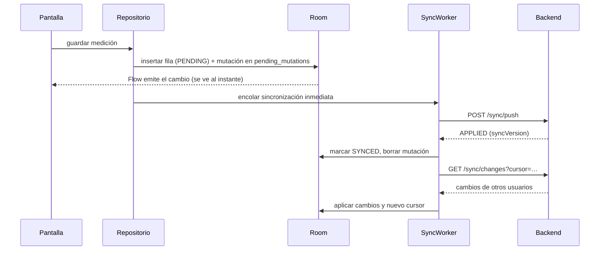

# 14 · Sincronización

Implementa RNF-OFF-01 a 06 con un protocolo simple de **traer cambios** y **enviar cambios**
(ADR-15). El mecanismo se construye en I0 e I1 porque todos los repositorios de la app dependen
de él; en I5 se completan la experiencia sin conexión (indicadores, errores) y sus pruebas.

## 1. Conceptos

| Concepto | Definición |
|---|---|
| **Entidad sincronizable** | Tabla cuyos cambios viajan al teléfono: `children`, `guardianships`, `care_links`, `measurements`, `applied_doses`, `other_vaccines`, `consultations` (sin `private_notes` de otros), `events`, `milestone_achievements`, `habits` |
| **Versión de sincronización** | Número global creciente que el servidor asigna a cada fila en cada cambio (`sync_version`, [13](13-base-de-datos.md#versión-de-sincronización)) |
| **Cursor** | La mayor versión que el teléfono ya recibió |
| **Lápida** | Fila marcada con `deleted_at`: viaja como borrado y el teléfono elimina su copia |
| **Alcance** | Qué niños sincroniza cada usuario (sección 4) |
| **Bandeja de salida** | Tabla local `pending_mutations` con los cambios hechos en el teléfono que todavía no confirmó el servidor |

## 2. Traer cambios

```
GET /api/v1/sync/changes?cursor=18342&patients=<uuid>,<uuid>
```

```json
{
  "cursor": 18517,
  "hasMore": false,
  "changes": {
    "children": [ … ],
    "measurements": [ { "id": "…", "childId": "…", "measuredOn": "2026-10-10", "weightKg": 7.25,
                        "authorAccountId": "…", "authorRole": "GUARDIAN", "deleted": false } ],
    "habits": [ … ]
  },
  "newChildIds": [ "…" ],
  "revokedChildIds": [ "…" ]
}
```

- Devuelve como máximo 500 filas por respuesta; si `hasMore` es `true`, la app vuelve a pedir con
  el nuevo cursor.
- **`newChildIds`**: niños que entraron al alcance desde el último cursor (por ejemplo, un vínculo
  aceptado o una invitación de tutor aceptada). Sus filas antiguas tienen versiones menores al
  cursor, así que la app pide una **foto completa** con `GET /sync/snapshot/{childId}` y la guarda.
- **`revokedChildIds`**: niños a los que el usuario perdió acceso (tabla `access_revocations`). La
  app borra todos sus datos locales y descarta sus cambios pendientes (RNF-OFF-05).

## 3. Enviar cambios

```
POST /api/v1/sync/push
```

```json
{
  "mutations": [
    { "mutationId": "…", "entity": "MEASUREMENT", "op": "UPSERT",
      "data": { "id": "…", "childId": "…", "measuredOn": "2026-10-14", "weightKg": 7.31, … } },
    { "mutationId": "…", "entity": "HABIT", "op": "DELETE", "data": { "id": "…" } }
  ]
}
```

```json
{
  "results": [
    { "mutationId": "…", "status": "APPLIED", "syncVersion": 18520 },
    { "mutationId": "…", "status": "REJECTED", "code": "business_rule", "rule": "RN-CRE-12",
      "message": "Ya cargaste una medición en esa fecha" }
  ]
}
```

| Regla | Detalle |
|---|---|
| Entidades admitidas | `MEASUREMENT`, `HABIT`, `EVENT`, `MILESTONE_ACHIEVEMENT` (ADR-28) |
| Idempotencia | `UPSERT` por `id` (UUID generado en el teléfono): reenviar el mismo lote produce el mismo resultado. `DELETE` de algo ya borrado es `APPLIED` |
| Validación | El servidor aplica las mismas reglas que en línea: permisos, autoría, rangos, reglas de negocio |
| Orden | Las mutaciones se aplican en el orden recibido, cada una en su propia transacción |
| Conflictos | Solo el autor edita un registro, así que solo pueden chocar dos teléfonos del mismo usuario: gana el último que llega al servidor |
| Rechazos | La app marca el registro local con el error y lo muestra para que el usuario lo corrija o lo descarte |
| Pediatra | Usa el mismo endpoint, pero la app solo lo permite con conexión (RNF-OFF-02 es solo para tutores) |

## 4. Alcance por rol (ADR-16)

| Rol | Se sincroniza | Se consulta en línea |
|---|---|---|
| Tutor | Todos sus hijos, con todas las entidades sincronizables | Informes, resumen de hábitos del servidor |
| Pediatra | Lista de pacientes con resumen (`GET /patients`, guardada para lectura sin conexión) y el detalle completo de los **pacientes abiertos recientemente** (hasta 50, el más antiguo sale primero), que se envían en `patients` | Hábitos: solo el resumen (`GET /children/{id}/habits/summary`), porque el detalle puede ser de miles de filas |
| Ambos perfiles en la misma cuenta | La unión de ambos alcances, separados por modo en la interfaz | — |

Las observaciones privadas solo viajan al dispositivo de su autor.

### 3.1 Implementación en el backend (I0-08)

`GET /sync/changes`, `GET /sync/snapshot/{childId}` y `POST /sync/push` son genéricos: no
conocen ninguna entidad en particular. Cada dominio sincronizable se enchufa implementando
`SyncEntity` (`backend/.../sync/`):

| Función | Qué hace |
|---|---|
| `changesSince(childIds, cursor, limit)` | Filas de esos niños con `sync_version` mayor al cursor, hasta `limit`, ascendente. Las lápidas van con `"deleted": true` |
| `snapshot(childId)` | Todas las filas vigentes de un niño, para `newChildIds` |
| `apply(caller, op, data)` | Aplica un `UPSERT` o `DELETE` del teléfono; idempotente por `id` |

Un `SyncRegistry` (mapa nombre → `SyncEntity`) es la única pieza que sabe qué entidades existen.
En I0 el registro de producción está vacío (`Dependencies.kt`); I1 registra `children`,
`measurements`, etc. a medida que cada dominio se adapta (ADR-28).

**Paginación de 500 filas entre varias entidades:** a cada entidad registrada se le pide
`limit + 1` filas (para detectar si ella sola ya supera el límite), se fusiona todo por
`sync_version` ascendente y se recortan las primeras 500. `hasMore` es `true` si lo fusionado
(antes de recortar) supera las 500 - así una sola entidad saturada no se cuenta mal aunque las
demás aporten pocas filas.

## 5. Datos de referencia y catálogos

| Datos | Cómo se actualizan |
|---|---|
| Tablas, umbrales y parámetros del motor de crecimiento | Al abrir la app y una vez por día: `GET /reference-data/version`; si cambió, `GET /reference-data` y se reemplaza en Room |
| Calendario, campañas, hitos, consejos, cronograma | Mismos momentos, con `ETag` / `If-None-Match` para no descargar si no cambiaron |

Sin la primera descarga de datos de referencia no se pueden calcular percentiles: la app la hace
durante el inicio de sesión y, si falla, la reintenta antes de mostrar resultados.

## 6. En la app



| Disparador | Trabajo |
|---|---|
| Después de cada escritura local | Sincronización inmediata (`OneTimeWorkRequest` con restricción de red, acelerado desde Android 12) |
| Periódico | Cada 15 minutos con red disponible (mínimo de WorkManager) |
| Al abrir la app o volver a ella | Traer cambios |
| "Sincronizar ahora" | Inmediato (RNF-OFF-03) |
| Aviso FCM de notificación | Traer cambios después de mostrarla |

- `SyncScheduler` (`core/sync`) encola los trabajos con nombre único: `sync-now` para los
  inmediatos y `sync-periodic` para el periódico. Un pedido inmediato nuevo reemplaza al que
  seguía esperando; es seguro porque reenviar cambios no los duplica.
- Antes de Android 12, un trabajo acelerado corre como servicio en primer plano y obliga a mostrar
  una notificación. Por eso ahí el inmediato se encola como trabajo normal, que con la app abierta
  igual corre en segundos.
- La app abre o vuelve al frente: `ProcessLifecycleOwner` pide una sincronización inmediata.
- Sin sesión no se sincroniza: la periódica se programa al iniciar o restaurar la sesión y todo se
  cancela al vencer o cerrarla ([15](15-android.md#4-sesión)).
- La inmediata y la periódica son trabajos distintos y pueden coincidir. Si dos sincronizaciones
  se pisan, un registro puede volver a una versión vieja. El motor de sincronización
  (I0-08 e I1) cumple dos reglas:
  - **Una sola a la vez:** usa un `Mutex`; la que llega segunda espera a que termine la primera.
  - **Nunca pisar con algo más viejo:** las filas del servidor no traen su `sync_version`, así
    que la regla se cumple con el mismo `Mutex`, que también toman las escrituras por REST
    (6.1). Cómo se protegen las filas locales con cambios sin enviar lo define la bandeja de
    salida (I1-A6).

- Cada fila local tiene `syncState`: `SYNCED`, `PENDING` o `ERROR` (RNF-OFF-04).
- La app guarda la fecha de la última sincronización exitosa y la muestra en Perfil.
- Al cerrar sesión se borran la base local y su clave (RF-CTA-07). Si hay mutaciones pendientes,
  primero se advierte (RF-CTA-07, CA2).

### 6.1 Implementación en la app (I1-A4)

`SyncEngine` (`core/sync`) trae los cambios; enviar la bandeja de salida llega con I1-A6. Igual
que en el backend, el motor no conoce ninguna entidad: cada dominio implementa `SyncedEntity` y la
registra con `@IntoSet` en su módulo de Hilt (`data/x/di/`).

| Función | Qué hace |
|---|---|
| `apply(row)` | Guarda una fila del servidor, o borra la copia local si es una lápida. Si la fila no se puede leer, el motor la saltea sin frenar el resto y el log registra solo cuántas fueron |
| `deleteChild(childId)` | Borra todas las filas locales de un niño |

Cada página se procesa así:

1. `GET /sync/changes` con el cursor guardado.
2. Se piden las fotos de los `newChildIds` **antes** de guardar nada: si una falla, la página no
   se guarda y la próxima sincronización vuelve a recibir esos niños. Si una foto responde 404, el
   niño salió del alcance entre los dos pedidos y se sigue sin él.
3. En una sola transacción: se borran los `revokedChildIds` en todas las entidades y en
   `pending_mutations`, se aplican los cambios y las fotos, y se guarda el cursor. Las
   revocaciones van primero para que un niño que se perdió y se recuperó vuelva con su foto.
4. Si `hasMore`, se repite con el cursor nuevo. Al terminar se guarda la hora de la
   sincronización en `sync_state`.

- **Lápida de un niño** (`CHILD` con `deleted`): borra sus datos de todas las entidades
  (RN-HIJ-08), porque el niño es la unidad del alcance.
- **Entidades sin manejador:** sus filas se ignoran y el cursor avanza igual. La tarea que agrega
  un manejador sube la versión de `PasitosDatabase`, y hasta el piloto la base se recrea y se
  vuelve a bajar todo desde el cursor 0.
- **Escrituras por REST** (hijos, tutores, vacunas): el repositorio hace el pedido y guarda la
  respuesta en Room dentro de `SyncEngine.withLock`, el mismo `Mutex` de la sincronización. O la
  sincronización en curso termina antes, o empieza después y ya baja la versión nueva: nunca pisa
  la respuesta con una fila vieja.
- **Eliminar un hijo** borra sus datos locales apenas responde el servidor, con el mismo camino que
  una revocación (`SyncEngine.forgetChild`). Si la app se cierra antes, lo borra la próxima
  sincronización por `revokedChildIds`.
- `SyncWorker` reintenta si no hay red. Si el servidor rechaza el pedido, termina, y la próxima
  sincronización periódica o el próximo disparador vuelven a probar.
