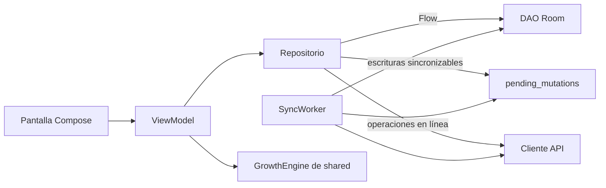

# 15 · App Android

## 1. Capas

Se mantiene la estructura actual (`core`, `data`, `feature`, `ui`), con un cambio central: los
repositorios leen de **Room** y no de la red (ADR-02).

| Capa | Responsabilidad | Regla |
|---|---|---|
| Pantalla (`feature/x/XScreen.kt`) | Dibujar el estado y enviar eventos | Sin lógica; recibe un `UiState` inmutable |
| ViewModel (`feature/x/XViewModel.kt`) | Combinar flujos de repositorios en un `StateFlow<UiState>` y ejecutar acciones | No conoce Room ni Ktor |
| Repositorio (`data/x/XRepository.kt`) | Única puerta a los datos del dominio | Lee de Room; escribe en Room y bandeja de salida (sincronizables) o llama a la API (en línea) |
| Local (`data/x/local/`) | Entidades y DAOs de Room | — |
| Remoto (`data/x/remote/`) | Llamadas a la API con DTOs de `shared` | — |

Las interfaces de repositorio actuales (`AuthRepository`, `ChildRepository`,
`MeasurementRepository`, …) se conservan; cambian sus implementaciones. Los ViewModels no deberían
necesitar cambios grandes.

## 2. Guía: agregar una pantalla con datos

1. Entidad y DAO en `data/x/local/` y registro en `PasitosDatabase`, subiendo su versión. **Hasta
   el piloto**, la base local se recrea al cambiar de versión (`fallbackToDestructiveMigration`):
   es una copia de datos del servidor y se vuelve a descargar, así que dos tareas en paralelo no
   necesitan coordinar migraciones. **Desde el piloto**, cada cambio lleva su migración de Room
   para no perder cambios pendientes de sincronizar.
2. DTOs en `shared/api` y llamadas en `data/x/remote/`.
3. Implementación del repositorio en `data/x/`. En `data/x/di/` van su `@Binds` y el `@Provides`
   de su DAO a partir de `PasitosDatabase`; el repositorio recibe el DAO inyectado. Después de
   cada escritura sincronizable llama a `SyncScheduler.requestSync(LOCAL_CHANGE)`.
4. `UiState`, ViewModel y pantalla en `feature/x/`. Para "hoy" se usa `ArgentinaClock.today()`,
   nunca `LocalDate.now()`, que depende de la zona horaria del teléfono (ADR-26).
5. Ruta en `core/navigation`.
6. Pruebas del ViewModel con un repositorio falso.
7. **Ejecutar la app** en emulador o dispositivo antes de abrir el PR (lección del proyecto: Hilt
   compila pero falla en ejecución si falta `@AndroidEntryPoint`).

## 3. Base local cifrada (ADR-17)

- Room con SQLCipher (`SupportOpenHelperFactory`), en `core/database`.
- La clave de la base son 32 bytes aleatorios generados en el primer uso, cifrados con una clave
  AES del **Android Keystore** mediante Tink y guardados en DataStore (`core/security`):
  - `LocalCipher` cifra con AES-256-GCM. Tink guarda su keyset en las preferencias
    `pasitos_keyset`, cifrado con la clave maestra del Keystore, que no se puede extraer del
    teléfono. Cada valor cifrado lleva un dato asociado según su uso, para que la clave de la base
    no se pueda descifrar como si fuera un token ni al revés.
  - La clave cifrada vive en el DataStore `secrets`, que también guarda la sesión (sección 4).
  - SQLCipher recibe la clave como clave cruda (`x'…'`): ya es aleatoria, así que no hace falta
    derivarla con PBKDF2 en cada apertura.
  - La clave se lee recién cuando Room abre el archivo, que siempre ocurre fuera del hilo
    principal.
- Hay una sola `PasitosDatabase` por proceso, creada por `LocalDatabase`. Hilt la inyecta, y
  también sus DAOs.
- **Cierre de sesión (RF-CTA-07):** no debe quedar nada de la sesión anterior, ni en el teléfono
  ni en memoria. `AuthRepository.logout()` lo hace en este orden:
  1. Si hay cambios pendientes, Perfil lo advierte y pide confirmación (CA2).
  2. Revocar la sesión en el servidor. Si responde 401, la sesión ya estaba vencida o revocada.
     Si el pedido no llega o el servidor falla, la sesión se cierra igual en el teléfono y la
     revocación queda pendiente (RF-CTA-07, CA3): el token de renovación se guarda cifrado en
     `secrets` y `RevokeSessionsWorker` la completa cuando hay red (ver abajo).
  3. Cancelar los trabajos de sincronización.
  4. Borrar la sesión guardada y llamar a `LocalDatabase.wipe()`, que cierra la base y borra el
     archivo y su clave (CA1).
  5. Reiniciar el proceso de la app (`ProcessRestarter`). Así desaparece todo lo que estaba en
     memoria: tokens, datos en repositorios y pantallas, la clave de la base en claro. Ningún
     componente tiene que acordarse de limpiarse.

  Desde el paso 2, la limpieza termina aunque el usuario salga de la pantalla. El reinicio se
  probó en Android 8 y 17.
- **Revocación pendiente:** para cerrar una sesión hace falta un token de acceso, que ya venció o
  se borró. `RevokeSessionsWorker` (trabajo único `revoke-sessions`, solo con red y con
  reintentos) renueva con el token guardado y cierra la sesión con el token de acceso nuevo. Si
  la renovación responde 401, la sesión ya no existe. Si el cierre falla después de renovar, el
  reintento usa el token guardado, que ya rotó: el backend lo toma como un reuso y revoca la
  sesión igual. Puede haber varias pendientes (por ejemplo, dos cierres sin conexión seguidos), y
  cada token se borra apenas se revoca su sesión. Si ni siquiera se puede guardar el token, el
  cierre sigue: sin el token nadie puede renovar la sesión, que vence a los 30 días.
- **Si la clave no se puede leer**, el archivo tampoco se puede abrir. Entonces se borra y se
  empieza con una base vacía; los datos vuelven del servidor. Lo cargado sin conexión y no enviado
  se pierde, porque sin la clave no se puede recuperar. Hay dos casos:
  - El valor guardado no se puede descifrar: se crea una clave nueva.
  - El cifrado mismo dejó de funcionar, por ejemplo porque el sistema invalidó la clave maestra
    del Keystore (pasa en algunos teléfonos después de actualizaciones del sistema): se borra el
    DataStore `secrets` completo, el keyset y la clave maestra, y se regeneran. Los tokens
    también se pierden, así que el usuario vuelve a iniciar sesión.
- **Riesgo aceptado:** si el Keystore no funciona en un teléfono desde el primer uso, Tink guarda
  el keyset sin cifrar dentro del almacenamiento privado de la app. Otras apps no lo pueden leer y
  Android cifra ese almacenamiento, pero falta la protección del Keystore. La app no se bloquea:
  lo registra en el log (y en Sentry desde I0-10) para saber cuántos teléfonos caen en este caso.
- La base, el DataStore `secrets` y el keyset quedan fuera de las copias de seguridad y del
  traspaso a otro teléfono (`backup_rules.xml` y `data_extraction_rules.xml`). Sin la clave del
  Keystore de origen, no se podrían descifrar en otro teléfono.
- Tablas de soporte: `pending_mutations`, `sync_state` (cursor, última sincronización),
  `active_child` (sección 11), `vaccination_calendar` (sección 12), `reference_data`, catálogos y caché de pacientes del pediatra. Las
  dos primeras existen desde I0.
- Las fechas del calendario se guardan como texto ISO (`2026-10-14`) y los momentos como
  milisegundos en UTC (`Converters`, ADR-26). "Hoy" sale de `ArgentinaClock.today()` (`core/time`).

## 4. Sesión

| Elemento | Implementación |
|---|---|
| Tokens | La cuenta y los tokens de acceso y renovación se guardan juntos en el DataStore `secrets`, cifrados con `LocalCipher` y su propio dato asociado (`SessionStore`). Solo `SessionRepository` y el cliente de la API los conocen; nunca van a logs |
| Renovación automática | El plugin `Auth` de Ktor Client agrega el token de acceso a cada pedido. Si el servidor responde 401, renueva los tokens y repite el pedido sin que el usuario lo note. Detalles abajo |
| Estado de sesión | `SessionRepository` expone `StateFlow<SessionState>`: restaurando, iniciada (con la cuenta) o cerrada (vencida o no). Al abrir la app se restaura desde DataStore, también sin conexión (RF-CTA-06, CA1 y CA3). Mientras se restaura no se muestra ni el login ni el inicio |
| Sincronización | Solo con sesión iniciada: al iniciarla o restaurarla se programa la periódica y se pide una inmediata; al vencer o cerrarla se cancelan |
| Google | Credential Manager con `GetSignInWithGoogleOption` y el ID del cliente web del proyecto (`GoogleConfig.WEB_CLIENT_ID`, [30](30-infraestructura.md#proyecto-de-google-cloud-y-firebase)). El ID token se envía a `POST /auth/google` ([11](11-backend.md#inicio-con-google-i1-b2)). Detalles abajo |
| Bloqueo con huella o PIN | `BiometricPrompt` con `BIOMETRIC_STRONG` o credencial del dispositivo. Se pide al abrir la app y al volver después de 5 minutos en segundo plano. Con el bloqueo activo se marca la ventana con `FLAG_SECURE` (RNF-SEG-08) |

**Renovación de tokens.** El backend revoca la sesión completa si recibe dos veces el mismo token
de renovación ([11](11-backend.md)), así que la app nunca debe reusarlo:

- Se renueva de a una vez: `SessionRepository.refresh()` toma un `Mutex` y compara el token
  rechazado con el vigente. Si ya cambió, otro pedido renovó antes y se repite el pedido con el
  nuevo, sin volver a renovar.
- Los tokens nuevos se guardan aunque se cancele el pedido que pidió la renovación
  (`nonCancellableRefresh`): el servidor ya invalidó los anteriores.
- El plugin no guarda los tokens en su caché (`cacheTokens = false`): los lee de
  `SessionRepository`, así iniciar o cerrar sesión no deja uno viejo en memoria.
- Registro e inicio de sesión llevan `withoutSession()`: no mandan token y un 401 por contraseña
  equivocada no dispara una renovación ni se reenvía (contaría doble para el bloqueo de
  RN-CTA-05).

**Sesión vencida (RF-CTA-06, CA2).** Si el servidor rechaza la renovación con 401, la sesión vence:
se borran los tokens y la app vuelve al login con "Tu sesión venció". La cuenta y la base local se
conservan, porque puede haber cambios sin sincronizar:

- Si vuelve a entrar la misma cuenta, sigue con sus datos y los cambios pendientes se envían.
- Si entra otra cuenta, se cancela la sincronización, se borra la base local y se reinicia la app
  antes de mostrar nada.

Cualquier otra respuesta a la renovación (por ejemplo, un 500) no cierra la sesión: se vuelve a
intentar en el próximo pedido.

**Riesgo aceptado:** si se pierde la respuesta de una renovación (se corta la red) o la app se
cierra antes de guardar los tokens nuevos, el próximo intento usa el token viejo y el backend lo
toma como un robo: revoca la sesión y el usuario vuelve a iniciarla, sin perder los datos locales.
El backend registra cada revocación por reuso y la app cada renovación rechazada, así se puede
medir cuánto pasa (con Sentry desde I0-10). Si pasa seguido, se puede agregar en el backend un
margen de unos segundos para aceptar el token anterior, sin cambiar la app.

**Inicio con Google (I1-A2).**

- `data/auth/google/`: la interfaz `GoogleCredentials` y su implementación con Credential Manager.
- **Por qué `GetSignInWithGoogleOption` y no `GetGoogleIdOption`:** es la opción para un botón
  explícito. Si el teléfono no tiene una cuenta de Google, ofrece agregarla. Si la persona cierra
  el diálogo varias veces, no deja de mostrarse por un tiempo, como sí pasa con la hoja de
  `GetGoogleIdOption`.
- **Contexto:** Credential Manager muestra el diálogo sobre la Activity. `LoginScreen` le pasa
  `LocalContext.current` a `LoginViewModel.onGoogleSignInClick`, que no lo retiene.
- **Cancelar:** si la persona cierra el diálogo, sigue en el login sin error (RF-CTA-03, CA3).
- **Primer ingreso:** el backend responde 409 `terms_required` sin guardar nada. El login pasa al
  paso "Completá tu cuenta", dentro de la misma pantalla, como el de "verificá tu email":
  - muestra la cuenta de Google elegida;
  - nombre y apellido precargados con los de Google y editables;
  - la casilla de términos sin marcar, con `PsTermsCheckbox`, la misma del registro.
- **"Crear cuenta":** reenvía **el mismo ID token** con `acceptTerms`, nombre y apellido.
  - Si pasó más de una hora y el token venció (401 `invalid_google_token`), vuelve al login con
    "Pasó mucho tiempo. Tocá «Continuar con Google» de nuevo".
  - "Cancelar" y "atrás" descartan el token.
- **El ID token** permite iniciar sesión como esa persona durante una hora. Entre el 409 y "Crear
  cuenta" queda solo en una variable privada de `LoginViewModel`. No va en el `UiState`, ni en el
  `SavedStateHandle`, ni en los argumentos de navegación, que Android puede escribir en disco. Si
  el sistema cierra la app en ese paso, se pierde y la persona vuelve a tocar el botón.
  `GoogleCredentialResult.Success.toString()` lo oculta.
- **Cerrar sesión** llama a `clearCredentialState()`, así el próximo ingreso con Google vuelve a
  preguntar qué cuenta usar.
- **Requisitos para probar:** el certificado que firma la app tiene que estar registrado en un
  cliente Android del proyecto, y la cuenta de Google en "Usuarios de prueba"
  ([30](30-infraestructura.md#certificados-de-debug)). El emulador necesita una imagen con Google
  Play.

## 5. Modos tutor y pediatra

- Un único `NavHost` con dos grafos: `tutorGraph` (Inicio, Crecimiento, Vacunas, Consejos,
  Perfil) y `pediatricianGraph` (Pacientes, Solicitudes, Perfil).
- El modo activo se guarda en la sesión y en el servidor (`accounts.last_mode`).
- Cambiar de modo navega al inicio del otro grafo y limpia la pila.

## 6. Notificaciones

1. `PasitosMessagingService` (FCM) recibe un aviso **de datos** con `notificationId`.
2. Encola un trabajo acelerado que llama a `GET /notifications/{id}`.
3. Construye la notificación local con título, cuerpo e intent al `deepLink` (RF-NOT-01, CA3).
4. Desde Android 13 se pide el permiso `POST_NOTIFICATIONS` en un momento con contexto (después
   del alta del primer hijo), no al abrir la app por primera vez.
5. El token FCM se registra con `PUT /me/devices/{token}` al iniciar sesión y cuando cambia.

## 7. Informes PDF

La app pide el PDF al backend, lo guarda en el almacenamiento propio de la app y lo ofrece con
`Intent.ACTION_SEND` mediante un `FileProvider` (RF-INF-04). "Guardar" usa el selector de
documentos del sistema (`ACTION_CREATE_DOCUMENT`), sin pedir permisos de almacenamiento.

## 8. Configuración por entorno

| Variante | URL del backend | Tráfico HTTP sin cifrar |
|---|---|---|
| `debug` | `http://localhost:8080` con `adb reverse tcp:8080 tcp:8080` (práctica actual del proyecto) | Permitido solo para `localhost` (configuración de seguridad de red de `debug`) |
| `pilot` | URL HTTPS del servidor del piloto. Muestra en todas las pantallas el aviso "Versión de prueba: no cargues datos de niños reales" (RNF-PRI-08) | No |
| `release` | URL HTTPS de producción | No |

La URL se define con `buildConfigField` por variante.

## 9. Accesibilidad e interfaz

- Componentes del Design System existente, con `contentDescription` en todo elemento
  interactivo y en los gráficos (RNF-ACC-03).
- Tamaños en `sp` para texto y verificación con escala de fuente del 200 % (RNF-ACC-02).
- Los estados siempre llevan ícono y texto (RNF-ACC-06).
- Curvas dibujadas con `Canvas` de Compose, con vista alternativa en tabla (RF-CRE-06, CA5).
- Formatos de número y fecha con `Locale("es", "AR")` (RNF-LOC-02 y 03).

## 10. Errores

Sentry Android con `sendDefaultPii = false` y un `beforeSend` que elimina breadcrumbs de red con
cuerpos y cualquier texto ingresado por el usuario (ADR-08).

## 11. Hijos (I1-A4)

| Tema | Implementación |
|---|---|
| Datos | `RoomChildRepository` lee `children` y `guardianships` de Room, que llegan por la sincronización (`CHILD` y `GUARDIANSHIP`, [14](14-sincronizacion.md#61-implementación-en-la-app-i1-a4)). El alta, la edición y la eliminación van por REST y guardan la respuesta con `SyncEngine.withLock` |
| Solo en línea | `NetworkMonitor` (`core/network`) deshabilita el alta, la edición y la eliminación sin red, y la pantalla lo avisa. Consultar el perfil y elegir el hijo activo funcionan sin conexión |
| Hijo activo | Tabla `active_child` de una sola fila (RF-HIJ-04, CA3): vive en la base local para borrarse con ella al cerrar sesión o al entrar otra cuenta. Si ese hijo ya no está, queda activo el primero de la lista, que va del mayor al menor. El alta deja activo al hijo nuevo (RF-HIJ-01, CA1) |
| Avatares | Las claves están en `AVATAR_KEYS` (`shared/api/child`) y el backend rechaza otras (RN-HIJ-11). `ChildAvatar` (`core/designsystem`) dibuja cada clave con un ícono de Material sobre un fondo pastel de la paleta; sin avatar, o con una clave que esa versión de la app no conoce, muestra la inicial |
| Medidas al nacer | Hasta I2 solo hay rangos absolutos fijos (`BirthMeasurementRanges`, PVM-06). Fuera de rango se pide revisar el valor y se guarda si el tutor confirma (RF-HIJ-01, CA4). El control por puntaje Z llega con I2-S2 y los rangos pasan a los datos de referencia con I2-B1 |
| Formulario | Uno solo para el alta y la edición (`PsRoute.ChildForm`, con `childId` al editar). Al editar la fecha de nacimiento, el sexo o las semanas de gestación pide una segunda confirmación por el recálculo (RF-HIJ-02, CA1) |
| Eliminación | La app pregunta al servidor si el usuario es el único tutor (`deletion-preview`), porque la lista local podría estar desactualizada. Si lo es, pide escribir el nombre de pila, sin distinguir mayúsculas, tildes ni espacios (RF-HIJ-09, CA1); si no, una confirmación simple (CA2) |

## 12. Vacunas (I1-A7)

| Tema | Implementación |
|---|---|
| Datos | `RoomVaccinationRepository` lee `applied_doses` y `other_vaccines` de Room, que llegan por la sincronización (`APPLIED_DOSE` y `OTHER_VACCINE`). Registrar, editar, eliminar y la carga retroactiva van por REST y guardan la respuesta con `SyncEngine.withLock`. Si al registrar una dosis el servidor responde `RN-VAC-09` (otro tutor la acaba de registrar), el repositorio pide sincronizar y la pantalla muestra el registro que llega |
| Calendario | Tabla `vaccination_calendar` de una sola fila con la respuesta de `GET /vaccination-calendar` en JSON y su `ETag`. Se reemplaza entera: la app siempre usa el calendario completo. Lo refresca `VaccinationCalendarReferenceData` después de cada sincronización ([14](14-sincronizacion.md#61-implementación-en-la-app-i1-a4)); una respuesta que no se puede leer no reemplaza la copia guardada |
| Estados | `doseStatuses()` de `shared/vaccination`, con `ArgentinaClock.today()`. Reemplaza al `DoseStatusResolver` anterior, que usaba la zona horaria del teléfono y solo tenía tres estados |
| Calendario en pantalla | Las dosis agrupadas por edad indicada ("Al nacer", "2 meses"…, "5 años"), cada una con su estado con ícono y texto (`DoseStatusBadge`, sobre `PsBadge` con el tono `Neutral` para "Programada"). Arriba, el resumen ("2 atrasadas · 1 próxima"), que también se muestra en Inicio, y un filtro por estado. Al final, las dosis de calendarios anteriores (si hay) y las otras vacunas, que solo se ven sin filtro porque no tienen estado (RF-VAC-01) |
| Detalle de una dosis | Una sola pantalla (`PsRoute.VaccineDetail(childId, doseCode)`): sin aplicar muestra el formulario; aplicada muestra sus datos y, si es propia, "Editar" y "Eliminar" con confirmación. La de otro tutor se ve en modo lectura con "La registró la familia" (40 · Modelo conceptual, Autoría). Una atrasada muestra el mensaje de RN-VAC-05. El selector de fecha va del nacimiento a hoy |
| Carga retroactiva | `PsRoute.PreviousDoses`: la pregunta "¿Tiene las vacunas al día para su edad?" y después la lista de dosis con fecha indicada anterior a hoy sin registrar, toda marcada con "Sí" y sin marcar con "No" o "No sé"; se guarda con un solo pedido (RF-VAC-04). Después del alta de un hijo, si le corresponden dosis, la app va a esta pantalla en lugar de a Inicio, con "Ahora no" (RF-HIJ-01, CA2). Si el calendario todavía no se bajó, se pide en ese momento |
| Otras vacunas | `PsRoute.OtherVaccine(childId, vaccineId?)`: una pantalla para crear, editar y eliminar, con sugerencias que completan el nombre ("Antigripal", "Fiebre amarilla", "Fiebre hemorrágica argentina") (RF-VAC-05) |
| Solo en línea | `NetworkMonitor` deshabilita registrar, editar y eliminar sin red, y la pantalla lo avisa. El calendario y los detalles se ven sin conexión |
| Límites de texto | Los de SUP-24, con las constantes de `shared/api/vaccination`: la app valida antes de enviar y muestra un contador |

## 13. Perfil y cuenta (I1-A3)

| Tema | Implementación |
|---|---|
| Datos | `AccountRepository` (`AccountApiRepository`) contra `/api/v1/me`. `GET /me` y `PATCH /me` guardan la cuenta que devuelve el servidor con `SessionRepository.updateAccount`, sin tocar los tokens. Todo necesita conexión (RF-CTA-11) |
| Datos actualizados y términos nuevos | `PasitosApplication` llama a `GET /me` al iniciar o restaurar la sesión, y cada vez que la app pasa a primer plano con sesión. Así se actualizan nombre, email (por ejemplo, después de confirmar un cambio desde la web) y `hasPassword`. Sin conexión falla y se ignora |
| Términos nuevos (RN-CTA-02) | Si `GET /me` informa `pendingTermsVersion`, `PsApp` muestra `TermsUpdateScreen` en lugar de toda la app, sin "atrás": la casilla sin marcar (`PsTermsCheckbox`), "Aceptar y continuar" (`POST /me/consents`) y "Cerrar sesión", con el aviso de cambios sin sincronizar. Su ViewModel vive mientras viva la Activity, así que vuelve a su estado inicial al aceptar y al dejar de mostrarse: si los términos cambian otra vez con la app abierta, la casilla no aparece marcada |
| Pantallas | En el perfil, la sección "Datos de la cuenta" abre una pantalla por dato (`PsRoute.EditName`, `ChangeEmail` y `ChangePassword`), porque cada cambio funciona distinto. Comparten `AccountFormScaffold`, que avisa si no hay conexión. Nombre y apellido se guardan al instante. El email pide la contraseña actual y muestra "Revisá tu email": no cambia hasta que se confirma (RF-CTA-11, CA1). La contraseña pide la actual y la nueva dos veces, con las reglas de RN-CTA-01, y cierra las demás sesiones (CA2) |
| Cuentas sin contraseña (RF-CTA-11, CA4) | `AccountDto.hasPassword` es falso en las cuentas creadas con Google y en las que perdieron la contraseña por RN-CTA-04. La fila dice "Crear una contraseña": la pantalla manda el email de recuperación a la cuenta propia (`POST /auth/password-reset`, sin token) y avisa que, al crearla, se cierran todas las sesiones, también esta. "Email" pide crear la contraseña primero |
| Última sincronización (RNF-OFF-04) | `SyncStatus` (`RoomSyncStatus`) expone `lastSyncedAt` de `sync_state` y la cantidad de cambios pendientes. El perfil muestra "Última sincronización: hoy a las 14:32 · 2 cambios sin sincronizar", en hora argentina ("hoy", "ayer" o la fecha) |

## 14. Mediciones (I1-A6)

| Tema | Implementación |
|---|---|
| Datos | `RoomMeasurementRepository` lee y escribe `measurements` en Room y en la bandeja de salida, así que cargar, editar y eliminar funcionan sin conexión (RNF-OFF-02). Las mediciones de los demás llegan por la sincronización (`MEASUREMENT`); `MeasurementSyncedEntity` es a la vez su `SyncedEntity` y su `OutboxEntity` ([14](14-sincronizacion.md#62-bandeja-de-salida-i1-a6)). Reemplaza a `MeasurementApiRepository`, que usaba los endpoints REST que el backend borró en I1-B6 |
| Una por fecha (RN-CRE-12) | Antes de guardar, el formulario busca una medición propia en esa fecha y, si la hay, ofrece editarla en lugar de guardar otra (RF-CRE-01, CA4). El repositorio repite el control en la transacción. Entre dos teléfonos sin conexión lo resuelve el servidor, que rechaza la segunda |
| Validación | Las reglas de `shared/growth/MeasurementValidation`, las mismas del backend: al menos un valor, fecha entre el nacimiento y hoy (`ArgentinaClock`), rango absoluto de entrada con el motivo ("El peso tiene que estar entre 0,1 y 150 kg"), hasta 3 decimales en el peso y 1 en la longitud o talla y el perímetro cefálico. La confirmación de valores atípicos (RF-CRE-01, CA3) llega con el puntaje Z en I2 (I2-S2, I2-B2): hasta entonces `outlierConfirmed` no se envía y el backend lo toma como falso |
| Forma de medición (RF-CRE-10) | Según la edad a la fecha de la medición: antes de los 24 meses viene seleccionado "Acostado" y desde entonces "De pie", cada uno con su ayuda breve; desde los 60 meses solo "De pie" (RN-CRE-03). Si el tutor elige la forma, cambiar la fecha ya no la cambia. El campo se llama "Longitud" o "Talla" según la forma |
| Perímetro cefálico | Solo se ofrece hasta los 5 años a la fecha de la medición (RN-CRE-01) |
| Pantalla | Una sola para cargar (`PsRoute.MeasurementForm(childId)`), editar o eliminar la propia con confirmación, y ver la de otra persona en modo lectura con "La cargó la familia" o "La cargó el pediatra" (`PsRoute.MeasurementForm(childId, measurementId)`, RF-CRE-02). Con un cambio rechazado muestra el motivo, y "Descartar cambio" además de guardar de nuevo. Un perfil finalizado no ofrece cargar mediciones (RF-CRE-01, CA6): para eso `ChildEntity` guarda el `status` que ya mandaba la fila `CHILD` |
| Historial (RF-CRE-03) | De la más reciente a la más antigua, con fecha, edad a la fecha (con la corregida en un prematuro, `formatAge` de `shared`), valores, autor ("Familia" o "Pediatra"; el nombre del profesional llega en I3) y la marca "Pendiente de sincronizar" o "No se pudo guardar". Las medidas al nacer van al final como primer punto (RN-CRE-14) y no se abren, porque se editan en el perfil del niño. Sin percentiles, IMC ni estado, que llegan en I2 |
| Inicio y Curvas | Leen las mediciones del hijo con `observeMeasurements(childId)`: Inicio muestra el último peso (con coma decimal, `toDecimalText()`) y Curvas los puntos cargados, sin datos de referencia hasta I2. En un perfil finalizado ninguna de las dos ofrece "Registrar medición" (RF-CRE-01, CA6) |

## 15. Tutores e invitaciones (I1-A5)

| Tema | Implementación |
|---|---|
| Datos | `GuardianRepository` (`GuardianApiRepository`) contra `/children/{id}/guardians`, `/guardian-invitations` y `/principal-transfer`, e `InvitationRepository` (`InvitationApiRepository`) contra `/me/invitations` e `/invitations/{id}`. Todo por REST y solo en línea: no se guarda nada en Room. Quitar a un tutor, ceder el rol y aceptar una invitación piden una sincronización, que trae las tutorías nuevas o, al aceptar, al niño en `newChildIds`; quien pierde el acceso lo recibe en `revokedChildIds` ([14](14-sincronizacion.md#61-implementación-en-la-app-i1-a4)) |
| Pantalla de tutores | `PsRoute.Guardians(childId)`, desde la fila "Tutores" del perfil del niño. La lista se pide al abrir y después de cada cambio, con el principal primero, el email de cada uno, la etiqueta "Principal" o "Secundario" y "(vos)". Sin conexión lo avisa y la pide sola al volver la red |
| Acciones del principal | "Invitar tutor" abre un diálogo con el email; los errores del servidor ("ya es tutor", RF-HIJ-05 CA4, y "ya hay una invitación vigente") se muestran en el mismo diálogo. Cada secundario tiene un menú ⋮ ("Opciones de …") con "Hacer tutor principal" (RF-HIJ-08) y "Quitar" (RF-HIJ-07, CA1), cada uno con su confirmación. El backend igual rechaza con 403 a quien no es principal |
| Invitaciones enviadas (RF-HIJ-05, CA3) | Solo el principal las ve, debajo de los tutores (`GET /children/{id}/guardian-invitations`): el email y "Vence el …" o, si `expired` (lo calcula el servidor), "Venció el …" con "Reenviar" (`POST /invitations/{id}/resend`), que la reemplaza por una nueva con 15 días más. Una vigente no se reenvía, para no mandar un email nuevo cada vez que se toca el botón |
| Dejar de ser tutor (RF-HIJ-07, CA2) | `ChildRepository.leaveChild` usa `DELETE /children/{id}/guardians/{propio}`, que le avisa al principal, y borra al niño del teléfono como la eliminación. Lo usan el botón del secundario en Tutores y "Eliminar perfil" del perfil del niño cuando el servidor dice que hay otros tutores (`deletion-preview`); con un único tutor, "Eliminar perfil" sigue usando `DELETE /children/{id}` con el nombre escrito (RF-HIJ-09). Tutores también consulta `deletion-preview` antes de confirmar: si el principal se fue mientras tanto, dejar de ser tutor eliminaría el perfil entero |
| Invitaciones recibidas (RF-HIJ-06) | `PsRoute.Invitations`: una tarjeta por invitación con quién invita, el niño y "Vence el …" en hora argentina, con "Aceptar" y "Rechazar". Aceptar pide la declaración "Soy madre, padre o representante legal de este niño o niña", sin marcar de entrada (CA1). Si el servidor responde `invitation_not_found` (venció o ya no existe, CA3), se muestra su mensaje y se actualiza la lista |
| Dónde aparecen | `InvitationRepository.pending` se actualiza al iniciar o restaurar la sesión y cada vez que la app pasa a primer plano, junto con `GET /me`, y se vacía al cerrar sesión. Inicio muestra una tarjeta ("Te invitaron a ser tutor de Tomi") mientras haya alguna, también sin hijos; Perfil tiene la fila "Invitaciones". Al verificar el email, si hay invitaciones, la app va a `Invitations(afterRegistration = true)` en lugar del alta de hijo, sin "atrás" y con "Ahora no", que sigue al alta (RF-HIJ-05, CA2) |
| Avisos | Los manda el backend por email. Las notificaciones dentro de la app llegan con el centro de notificaciones (I6) |
