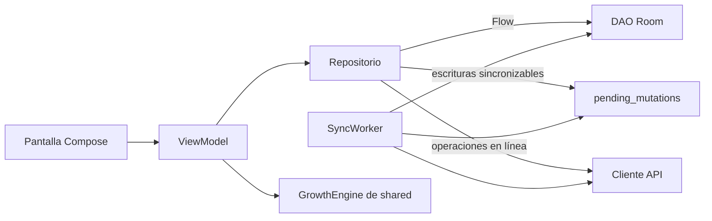

# 15 · App Android

## 1. Capas

Se mantiene la estructura actual (`core`, `data`, `feature`, `ui`), con un cambio central: los
repositorios leen de **Room** y no de la red (ADR-02).

| Capa | Responsabilidad | Regla |
|---|---|---|
| Pantalla (`feature/x/XScreen.kt`) | Dibujar el estado y enviar eventos | Sin lógica; recibe un `UiState` inmutable |
| ViewModel (`feature/x/XViewModel.kt`) | Combinar flujos de repositorios en un `StateFlow<UiState>` y ejecutar acciones | No conoce Room ni Ktor |
| Repositorio (`data/x/XRepository.kt`) | Única puerta a los datos del dominio | Lee de Room; escribe en Room y bandeja de salida (sincronizables) o llama a la API (en línea) |
| Local (`data/x/local/`) | Entidades y DAOs de Room | — |
| Remoto (`data/x/remote/`) | Llamadas a la API con DTOs de `shared` | — |

Las interfaces de repositorio actuales (`AuthRepository`, `ChildRepository`,
`MeasurementRepository`, …) se conservan; cambian sus implementaciones. Los ViewModels no deberían
necesitar cambios grandes.

## 2. Guía: agregar una pantalla con datos

1. Entidad y DAO en `data/x/local/` y registro en `PasitosDatabase` (con migración de Room si la
   base ya existía).
2. DTOs en `shared/api` y llamadas en `data/x/remote/`.
3. Implementación del repositorio y su `@Binds` en `data/x/di/`.
4. `UiState`, ViewModel y pantalla en `feature/x/`.
5. Ruta en `core/navigation`.
6. Pruebas del ViewModel con un repositorio falso.
7. **Ejecutar la app** en emulador o dispositivo antes de abrir el PR (lección del proyecto: Hilt
   compila pero falla en ejecución si falta `@AndroidEntryPoint`).

## 3. Base local cifrada (ADR-17)

- Room con SQLCipher (`SupportOpenHelperFactory`).
- La clave de la base son 32 bytes aleatorios generados en el primer uso, cifrados con una clave
  AES del **Android Keystore** mediante Tink y guardados en DataStore.
- Al cerrar sesión se borran el archivo de la base y la clave.
- Tablas de soporte: `pending_mutations`, `sync_state` (cursor, última sincronización),
  `reference_data`, catálogos y caché de pacientes del pediatra.

## 4. Sesión

| Elemento | Implementación |
|---|---|
| Tokens | Acceso y renovación guardados en DataStore, cifrados con Tink y el Android Keystore |
| Renovación automática | El plugin `Auth` de Ktor Client renueva el token de acceso cuando el servidor responde 401 y reintenta el request. Si la renovación falla, se cierra la sesión |
| Estado de sesión | `SessionRepository` expone `StateFlow<Session?>` con cuenta, perfiles y modo activo. Al iniciar la app se restaura desde DataStore (RF-CTA-06) |
| Google | Credential Manager con `GetGoogleIdOption` (client ID web del proyecto). El ID token se envía a `POST /auth/google` |
| Bloqueo con huella o PIN | `BiometricPrompt` con `BIOMETRIC_STRONG` o credencial del dispositivo. Se pide al abrir la app y al volver después de 5 minutos en segundo plano. Con el bloqueo activo se marca la ventana con `FLAG_SECURE` (RNF-SEG-08) |

## 5. Modos tutor y pediatra

- Un único `NavHost` con dos grafos: `tutorGraph` (Inicio, Crecimiento, Vacunas, Consejos,
  Perfil) y `pediatricianGraph` (Pacientes, Solicitudes, Perfil).
- El modo activo se guarda en la sesión y en el servidor (`accounts.last_mode`).
- Cambiar de modo navega al inicio del otro grafo y limpia la pila.

## 6. Notificaciones

1. `PasitosMessagingService` (FCM) recibe un aviso **de datos** con `notificationId`.
2. Encola un trabajo acelerado que llama a `GET /notifications/{id}`.
3. Construye la notificación local con título, cuerpo e intent al `deepLink` (RF-NOT-01, CA3).
4. Desde Android 13 se pide el permiso `POST_NOTIFICATIONS` en un momento con contexto (después
   del alta del primer hijo), no al abrir la app por primera vez.
5. El token FCM se registra con `PUT /me/devices/{token}` al iniciar sesión y cuando cambia.

## 7. Informes PDF

La app pide el PDF al backend, lo guarda en el almacenamiento propio de la app y lo ofrece con
`Intent.ACTION_SEND` mediante un `FileProvider` (RF-INF-04). "Guardar" usa el selector de
documentos del sistema (`ACTION_CREATE_DOCUMENT`), sin pedir permisos de almacenamiento.

## 8. Configuración por entorno

| Variante | URL del backend | Tráfico HTTP sin cifrar |
|---|---|---|
| `debug` | `http://localhost:8080` con `adb reverse tcp:8080 tcp:8080` (práctica actual del proyecto) | Permitido solo para `localhost` (configuración de seguridad de red de `debug`) |
| `pilot` | URL HTTPS del servidor del piloto | No |
| `release` | URL HTTPS de producción | No |

La URL se define con `buildConfigField` por variante.

## 9. Accesibilidad e interfaz

- Componentes del Design System existente, con `contentDescription` en todo elemento
  interactivo y en los gráficos (RNF-ACC-03).
- Tamaños en `sp` para texto y verificación con escala de fuente del 200 % (RNF-ACC-02).
- Los estados siempre llevan ícono y texto (RNF-ACC-06).
- Curvas dibujadas con `Canvas` de Compose, con vista alternativa en tabla (RF-CRE-06, CA5).
- Formatos de número y fecha con `Locale("es", "AR")` (RNF-LOC-02 y 03).

## 10. Errores

Sentry Android con `sendDefaultPii = false` y un `beforeSend` que elimina breadcrumbs de red con
cuerpos y cualquier texto ingresado por el usuario (ADR-08).
