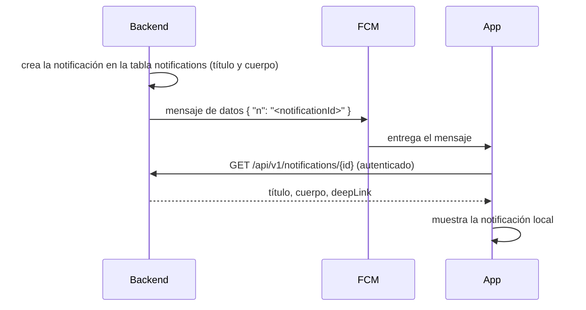

# 17 · Notificaciones y emails

## 1. Push sin datos personales (ADR-06)

Firebase Cloud Messaging es un servicio de Google en Estados Unidos, país sin nivel adecuado de
protección según la AAIP. Para que no reciba datos personales ni de salud:

- El mensaje FCM es **solo de datos** (sin bloque `notification`), con prioridad alta para que se
  entregue aunque el teléfono esté en reposo.
- Google solo ve el token del dispositivo y un UUID que no significa nada fuera de Pasitos.
- Si la app no logra traer el contenido (sin conexión), muestra "Tenés novedades en Pasitos" y
  el detalle aparece en el centro de notificaciones al volver la conexión.
- RN-NOT-04 se cumple igual: el título y el cuerpo nunca incluyen datos clínicos.

## 2. Generación

| Tipo | Quién la crea | Cuándo |
|---|---|---|
| N-01, N-02, N-03, N-08 | Tarea `daily-notifications` | 09:00 hora argentina (ADR-18) |
| N-04, N-09 (vencimientos) | Tarea `expire-invitations` | Al vencer |
| N-04 a N-07, N-09 a N-12 | El servicio del dominio | En el momento del hecho |
| N-13 | No genera push: contador en el panel | — |

- Cada notificación tiene una `dedup_key` (por ejemplo, `N02:<childId>:<doseCode>`), única por
  cuenta: si la tarea se ejecuta dos veces, no se duplica (RF-NOT-03, CA1).
- Antes de enviar el push se consultan las preferencias del destinatario (RF-NOT-02). La
  notificación se guarda igual para el centro de notificaciones.
- Se envía a todos los dispositivos registrados de la cuenta. Si FCM informa que un token ya no
  es válido, se borra de `devices`.
- Los textos se arman con plantillas en el backend, con el nombre de pila del niño y en voseo
  (ver ejemplos en la tabla de tipos de la SPEC funcional).

## 3. Emails transaccionales (ADR-07)

| Email | Disparador | Vencimiento del link |
|---|---|---|
| Verificación de email | Registro, reenvío, cambio de email | 24 horas |
| Recuperación de contraseña | `POST /auth/password-reset` | 60 minutos |
| Aviso al email anterior | Cambio de email confirmado | — |
| Invitación de tutor | RF-HIJ-05 | 15 días |
| Invitación a pediatra | RF-PED-09 | 15 días |
| Invitación a reclamar perfil | RF-PED-12 | 15 días |
| Resultado de validación de pediatra | RF-ADM-02 | — |
| Definir contraseña de administrador | RF-ADM-01 | 24 horas |

- Envío por **SMTP** con un proveedor con servidores en la Unión Europea y plan gratuito (por
  ejemplo, Brevo). Usar SMTP y no la API propietaria permite cambiar de proveedor modificando solo
  variables de entorno.
- Plantillas HTML con Thymeleaf y versión de texto plano.
- Remitente con dominio propio, configurado con SPF, DKIM y DMARC para no caer en spam (requiere
  el dominio, pendiente P-03).
- El envío se hace fuera de la transacción del request, con reintentos. Un fallo de email no hace
  fallar la operación (la invitación queda creada y se puede reenviar).
- En `local` y `ci`, los emails se capturan con un servidor SMTP de prueba en Docker (Mailpit) y
  nunca salen a internet.
