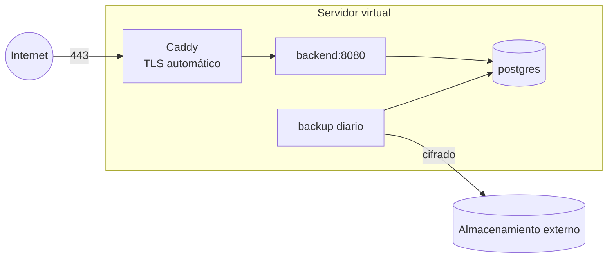

# 30 · Infraestructura

## Entornos

| Entorno | Para qué | Dónde | Datos |
|---|---|---|---|
| `local` | Desarrollo y demos quincenales | La computadora de cada integrante, con Docker | Ficticios |
| `ci` | Pruebas automáticas en cada PR | GitHub Actions | Ficticios, creados por las pruebas |
| `pilot` | Prueba piloto con usuarios | Proveedor a definir (ADR-05, P-01) | Ficticios, cargados por los participantes. Solo el nombre y el email de sus cuentas son reales (RNF-PRI-08) |

No se define un entorno de producción para la tesis: el piloto cumple ese rol.

## Local

`docker-compose.yml` en la raíz:

| Servicio | Imagen | Uso |
|---|---|---|
| `db` | `postgres:16-alpine` | Base de desarrollo. Puerto configurable con `DB_PORT` (5433 por defecto, igual que `backend/.env.example`) |
| `mailpit` | `axllent/mailpit`, versión fija | Captura los emails sin enviarlos; se ven en `http://localhost:8025`. SMTP en el puerto 1025 |
| `backend` | Imagen propia | Opcional, con el perfil `full` (`docker compose --profile full up`). Se reconstruye en cada `up` para correr el código actual. Lo habitual es correr el backend desde IntelliJ |

- Los puertos se publican solo en `127.0.0.1`: la base, con su contraseña de desarrollo, y los
  emails capturados no quedan abiertos a otras computadoras de la red.
- Dentro de Docker, el backend se conecta a `db:5432` y a `mailpit:1025`. Las variables de
  `backend/.env` le llegan con `--env-file backend/.env`; sin ese archivo, los valores por
  defecto de `docker-compose.yml` son los de `.env.example`.

Para usar la app en un teléfono o emulador contra el backend local:
`adb reverse tcp:8080 tcp:8080` (práctica vigente del proyecto).

## Imagen del backend

`backend/Dockerfile` en dos etapas:

1. **Build:** `eclipse-temurin:21-jdk-noble` compila `shared` y `backend` y genera la
   distribución con `./gradlew installDist`. Se construye desde la raíz del repositorio, porque
   el backend incluye a `shared` como build compuesto.
2. **Ejecución:** `eclipse-temurin:21-jre-alpine` con la distribución del backend (unos 200 MB en
   total). Corre con un usuario sin privilegios (`pasitos`, uid 10001) que no puede modificar los
   archivos de la aplicación, en el puerto 8080, con `HEALTHCHECK` sobre `/health`. La JVM usa
   hasta el 75 % de la memoria del contenedor.

- **Sin secretos:** `.dockerignore`, en la raíz, deja entrar al contexto de construcción solo
  `backend/` y `shared/`. De ahí saca los mismos secretos que `.gitignore` (`.env`, `*.pem`,
  `*.jks` y `*.keystore`), las carpetas `build/` y las pruebas. Toda la configuración llega por
  variables de entorno ([11](11-backend.md#7-configuración)).
- **Imágenes base fijadas por digest**, con la etiqueta como referencia, para que una etiqueta
  movida no cambie lo que se construye. Dependabot las actualiza
  ([31](31-calidad-y-ci.md#dependabot)).
- La integración continua construye la imagen y levanta el entorno local completo
  ([31](31-calidad-y-ci.md#2-integración-continua-adr-14)).

La misma imagen corre en cualquier proveedor que ejecute contenedores (ADR-05).

## Piloto

### Requisitos para elegir el proveedor (P-01)

| Requisito | Motivo |
|---|---|
| Servidores en Argentina o en un país con nivel adecuado de protección según la AAIP (Unión Europea, Reino Unido, Uruguay, entre otros) | Art. 12 de la Ley 25.326 (RNF-PRI-09). Con datos ficticios no es obligatorio para el piloto (solo viajan nombre y email de los participantes), pero se recomienda: el mismo despliegue serviría para producción sin mudarse |
| Ejecuta contenedores Docker | Imagen del backend |
| Disco cifrado | RNF-SEG-02 |
| Costo total hasta USD 30 por mes | Presupuesto del equipo |
| Fecha límite de la decisión | Antes de I6, para probar el despliegue antes del piloto |

### Despliegue de referencia

Con un servidor virtual (opción más económica, entre USD 5 y 10 por mes):

- `docker compose` con `caddy`, `backend`, `db` y `backup`.
- El contenedor del backend lleva un límite de memoria (`mem_limit`). La JVM usa hasta el 75 %
  de la memoria de su contenedor; sin límite, ese 75 % se calcularía sobre toda la del servidor
  y podría quitarle memoria a PostgreSQL.
- Solo el puerto 443 (y el 80 para la renovación de certificados) abierto al exterior. Acceso de
  administración por SSH con clave, sin contraseña.
- Despliegue: GitHub Actions construye la imagen al crear una etiqueta `pilot-vX.Y.Z`, la publica
  en GitHub Container Registry (privado) y el servidor la descarga con `docker compose pull && up`.

Si se elige una plataforma administrada (PaaS) en lugar de un servidor virtual, se mantiene la
misma imagen y se reemplazan Caddy y la base por los servicios equivalentes del proveedor.

### Copias de seguridad

| Elemento | Definición |
|---|---|
| Frecuencia | Diaria, 03:00 hora argentina |
| Método | `pg_dump` comprimido y cifrado con `age` |
| Destino | Almacenamiento externo al servidor, en un país con nivel adecuado |
| Retención | 14 diarias y 8 semanales |
| Prueba | Restauración completa en un entorno aparte antes de iniciar el piloto y una vez por mes durante el piloto (RNF-SEG-09) |

## Publicación de la app

| Elemento | Definición |
|---|---|
| Cuenta de Google Play | La saca un integrante del equipo (P-06) |
| Firma | Firma de apps de Google Play: Google guarda la clave de firma. El equipo guarda la clave de subida (*upload key*) en un gestor de contraseñas compartido, nunca en el repositorio (P-08) |
| Builds internos | Firebase App Distribution para versiones de prueba del equipo |
| Piloto | Prueba cerrada de Google Play con los participantes del piloto (ADR-13) |
| Identificador | `com.pasitos.app` desde I0, antes de la primera subida (ADR-12) |

## Proyecto de Google Cloud y Firebase

Creado el 22/10/2026 (T-08, #62). Lo usa el inicio de sesión con Google (I1-B2 e I1-A2), y desde
I6 también FCM y App Distribution (I6-B2 e I6-A1).

| Elemento | Definición |
|---|---|
| Cuenta dueña | `cervantes.app.pasitos@gmail.com`: una cuenta de Google del equipo, no personal, con verificación en dos pasos. Su contraseña y sus códigos de respaldo están en el gestor de contraseñas de Nelson. Los cuatro integrantes también son propietarios del proyecto con su propia cuenta: el trabajo diario no pasa por la cuenta del equipo, y el proyecto no queda sin dueño si se pierde su acceso |
| Proyecto | **Pasitos**, ID `pasitos-751c4`. Plan Spark de Firebase, gratuito y sin cuenta de facturación. Google Analytics desactivado |
| Pantalla de consentimiento | En Google Auth Platform, con público externo y en estado **"Prueba"**: solo pueden iniciar sesión con Google las cuentas cargadas como usuarios de prueba, hasta 100. No pide permisos adicionales: `openid`, `email` y `profile` vienen incluidos y no requieren que Google revise la app. Antes del piloto se le agregan los links a la política de privacidad y a la página principal (T-14) y se publica. No lleva logo, porque obligaría a esa revisión |
| Cliente web | `627692337820-lao7eidv67os92k7mpqhrgoudh2belf9.apps.googleusercontent.com` (`Pasitos web (aud del backend)`). Es el `aud` que valida el backend (`GOOGLE_CLIENT_ID`, [11](11-backend.md#7-configuración)) y el `serverClientId` de `GetGoogleIdOption` en la app ([15](15-android.md#4-sesión)). No es secreto: queda dentro del APK. No tiene orígenes ni URIs de redireccionamiento. Su secreto de cliente no se usa, y no se guarda ni se versiona |
| Clientes Android | Uno por cada certificado que firma la app, con el paquete `com.pasitos.app` y el SHA-1 del certificado. Sin ese registro, Credential Manager no ofrece cuentas de Google. Ver abajo |
| App Android en Firebase | `com.pasitos.app` ("Pasitos Android"), registrada sin SHA-1: los certificados se registran en los clientes Android, y cargarlos también en Firebase crearía clientes duplicados. El `google-services.json` todavía no se descargó: se agrega en I6, con FCM, y ahí se decide si va al repositorio |

### Certificados de debug

Cada computadora tiene su propia clave de debug (`~/.android/debug.keystore`). Cada integrante la
registra en un cliente Android propio, llamado `Pasitos Android (debug <usuario>)`. No se versiona
una clave de debug compartida, porque ninguna clave va al repositorio.

- La lista vigente de clientes está en la consola, en Google Auth Platform → Clientes. El SHA-1 de
  cada integrante queda en el comentario de cierre de su issue.
- Registrados: `Pasitos Android (debug Nelson)`. Pendientes: #116 (SELazo), #117
  (juanpabloguingold) y #118 (caromanzuelli). Esos issues tienen el paso a paso completo.
- El SHA-1 se obtiene de cualquiera de estas dos formas:
  - Desde `app/`, con `./gradlew signingReport`, en el bloque `Variant: debug`. Necesita
    `JAVA_HOME`, por ejemplo apuntando al JDK de Android Studio.
  - Con `keytool -J-Duser.language=en -list -v -keystore ~/.android/debug.keystore -alias
    androiddebugkey -storepass android`. `android` es la contraseña predeterminada de todas las
    claves de debug. Con el sistema en español, sin `-J-Duser.language=en`, `keytool` falla con
    `MissingFormatArgumentException` al mostrar el certificado.
- El SHA-1 es una huella pública y se puede compartir. La clave `debug.keystore`, no.
- En I6 se suma el cliente del certificado de firma de Google Play (P-06, P-08).

## Servicios externos y costos estimados

| Servicio | Plan | Costo |
|---|---|---|
| GitHub (repositorio, Actions, Projects, Container Registry) | Gratuito | USD 0 |
| Google Cloud y Firebase (inicio con Google, FCM, App Distribution) | Gratuito (plan Spark de Firebase) | USD 0 |
| Sentry (región UE) | Gratuito | USD 0 |
| Email transaccional (región UE) | Gratuito, alrededor de 300 emails por día | USD 0 |
| Google Play | Pago único | USD 25 |
| Dominio | Anual | Alrededor de USD 10–20 por año (P-03) |
| Servidor del piloto | Mensual, desde que se despliega | USD 5–10 por mes con servidor virtual |
| Almacenamiento de copias de seguridad | Mensual | Menos de USD 1 por mes |
