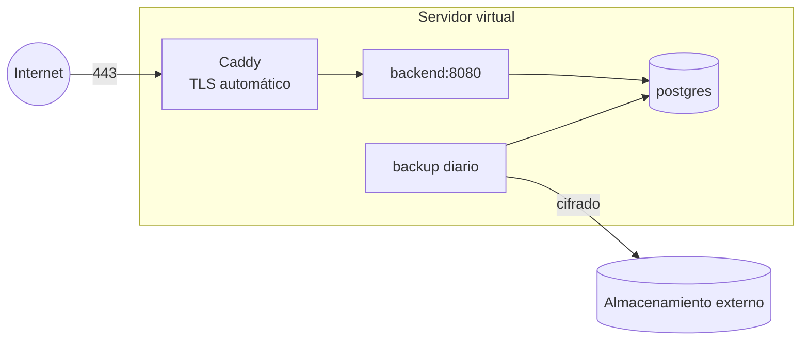

# 30 · Infraestructura

## Entornos

| Entorno | Para qué | Dónde | Datos |
|---|---|---|---|
| `local` | Desarrollo y demos quincenales | La computadora de cada integrante, con Docker | Ficticios |
| `ci` | Pruebas automáticas en cada PR | GitHub Actions | Ficticios, creados por las pruebas |
| `pilot` | Prueba piloto con usuarios reales | Proveedor a definir (ADR-05, P-01) | **Reales** |

No se define un entorno de producción para la tesis: el piloto cumple ese rol.

## Local

`docker-compose.yml` en la raíz:

| Servicio | Imagen | Uso |
|---|---|---|
| `db` | `postgres:16-alpine` | Base de desarrollo (ya existe). Puerto configurable con `DB_PORT` |
| `mailpit` | `axllent/mailpit` | Captura los emails; se ven en `http://localhost:8025` |
| `backend` | Imagen propia | Opcional, con el perfil `full`. Lo habitual es correr el backend desde IntelliJ |

Para usar la app en un teléfono o emulador contra el backend local:
`adb reverse tcp:8080 tcp:8080` (práctica vigente del proyecto).

## Imagen del backend

`backend/Dockerfile` en dos etapas:

1. **Build:** imagen con JDK 21 que compila `shared` y `backend` y genera la distribución con
   `./gradlew installDist`.
2. **Ejecución:** imagen JRE 21 mínima, usuario sin privilegios, puerto 8080, `HEALTHCHECK` sobre
   `/health`.

Toda la configuración llega por variables de entorno ([11](11-backend.md#7-configuración)). La
misma imagen corre en cualquier proveedor que ejecute contenedores (ADR-05).

## Piloto

### Requisitos para elegir el proveedor (P-01)

| Requisito | Motivo |
|---|---|
| Servidores en Argentina o en un país con nivel adecuado de protección según la AAIP (Unión Europea, Reino Unido, Uruguay, entre otros) | Art. 12 de la Ley 25.326 (RNF-PRI-09) |
| Ejecuta contenedores Docker | Imagen del backend |
| Disco cifrado | RNF-SEG-02 |
| Costo total hasta USD 30 por mes | Presupuesto del equipo |
| Fecha límite de la decisión | Antes de I6, para probar el despliegue antes del piloto |

### Despliegue de referencia

Con un servidor virtual (opción más económica, entre USD 5 y 10 por mes):

- `docker compose` con `caddy`, `backend`, `db` y `backup`.
- Solo el puerto 443 (y el 80 para la renovación de certificados) abierto al exterior. Acceso de
  administración por SSH con clave, sin contraseña.
- Despliegue: GitHub Actions construye la imagen al crear una etiqueta `pilot-vX.Y.Z`, la publica
  en GitHub Container Registry (privado) y el servidor la descarga con `docker compose pull && up`.

Si se elige una plataforma administrada (PaaS) en lugar de un servidor virtual, se mantiene la
misma imagen y se reemplazan Caddy y la base por los servicios equivalentes del proveedor.

### Copias de seguridad

| Elemento | Definición |
|---|---|
| Frecuencia | Diaria, 03:00 hora argentina |
| Método | `pg_dump` comprimido y cifrado con `age` |
| Destino | Almacenamiento externo al servidor, en un país con nivel adecuado |
| Retención | 14 diarias y 8 semanales |
| Prueba | Restauración completa en un entorno aparte antes de iniciar el piloto y una vez por mes durante el piloto (RNF-SEG-09) |

## Publicación de la app

| Elemento | Definición |
|---|---|
| Cuenta de Google Play | La saca un integrante del equipo (P-06) |
| Firma | Firma de apps de Google Play: Google guarda la clave de firma. El equipo guarda la clave de subida (*upload key*) en un gestor de contraseñas compartido, nunca en el repositorio (P-08) |
| Builds internos | Firebase App Distribution para versiones de prueba del equipo |
| Piloto | Prueba cerrada de Google Play con los participantes del piloto (ADR-13) |
| Identificador | `com.pasitos.app` desde I0, antes de la primera subida (ADR-12) |

## Servicios externos y costos estimados

| Servicio | Plan | Costo |
|---|---|---|
| GitHub (repositorio, Actions, Projects, Container Registry) | Gratuito | USD 0 |
| Firebase (FCM, App Distribution) | Gratuito | USD 0 |
| Sentry (región UE) | Gratuito | USD 0 |
| Email transaccional (región UE) | Gratuito, alrededor de 300 emails por día | USD 0 |
| Google Play | Pago único | USD 25 |
| Dominio | Anual | Alrededor de USD 10–20 por año (P-03) |
| Servidor del piloto | Mensual, desde que se despliega | USD 5–10 por mes con servidor virtual |
| Almacenamiento de copias de seguridad | Mensual | Menos de USD 1 por mes |
