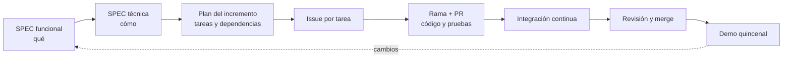

# 32 · Proceso de desarrollo

## 1. Flujo de Spec-Driven Development

- Un cambio de comportamiento empieza en la SPEC, nunca en el código.
- Si durante la implementación aparece un hueco o una contradicción en la SPEC, se frena esa parte,
  se resuelve en la SPEC (PR propio, aunque sea chico) y después se sigue.

## 2. Tareas

Cada tarea es un **issue de GitHub** dentro del tablero de GitHub Projects (ADR-22):

| Campo | Contenido |
|---|---|
| Título | Verbo + resultado: "Implementar alta de hijo (backend)" |
| Descripción | RF y RN que cubre, criterios de aceptación, archivos o módulos que toca, dependencias |
| Etiquetas | Incremento (`I0`…`I6`), componente (`backend`, `android`, `shared`, `admin`, `docs`) |
| Responsable | Quien la toma (asignación) |
| Estado en el tablero | `Por hacer` → `En curso` → `En revisión` → `Hecho` |

Los issues los crea el plan de cada incremento, con las dependencias marcadas para saber qué se
puede hacer en paralelo.

## 3. Ramas y PRs

Se mantiene el flujo de [`CONTRIBUTING.md`](../../CONTRIBUTING.md) y se agrega:

- Nombre de rama con el número de issue: `feature/42-alta-de-hijo`.
- El PR menciona `Closes #42` para cerrar el issue al mergear.
- **PR en borrador temprano:** apenas se empieza una tarea, se pushea la rama y se abre el PR como
  *draft*. Así el resto del equipo ve qué está en curso y qué archivos se están tocando.

## 4. Trabajo en paralelo

### Antes de tomar una tarea

Todo integrante, y **todo agente de IA que trabaje en nombre de un integrante**, verifica que la
tarea no esté en curso:

1. El issue no tiene responsable y está en `Por hacer`.
2. No existe una rama remota con el número del issue: `git fetch --prune` y
   `git branch -r | grep "/<número>-"`.
3. No hay un PR abierto que la mencione: `gh pr list --search "<número>"`.
4. Las tareas de las que depende ya están en `Hecho`.

Si cualquiera de los cuatro puntos falla, **no se toma la tarea**: se elige otra o se consulta con
quien la tiene. Recién después se asigna el issue, se mueve a `En curso` y se crea la rama.

> **Nota para agentes de IA:** antes de crear una rama o modificar código
> para una tarea, ejecutá las verificaciones 1 a 4 de esta sección e informá el resultado. Si
> encontrás trabajo en curso sobre la misma tarea o sobre los mismos archivos, detenete y
> consultá a la persona con la que estás trabajando. No asumas que una tarea está libre porque
> no la ves en tu copia local.

Estas verificaciones y la nota para agentes están también en
[`CONTRIBUTING.md`](../../CONTRIBUTING.md#antes-de-tomar-una-tarea-personas-y-agentes-de-ia),
que es lo primero que leen tanto las personas como los agentes al trabajar en el repositorio.

### Puntos de conflicto y cómo evitarlos

| Punto de conflicto | Regla |
|---|---|
| Migraciones de base de datos | Versión por fecha y hora (ADR-23); una migración por PR |
| Contratos de la API en `shared/api` | El PR que cambia un contrato incluye el ajuste del backend; la app se adapta en un PR siguiente. No se cambian contratos que otro integrante está usando en una tarea en curso sin avisar |
| Registro de rutas (`Application.module()`) | Cada dominio expone una única función `xRoutes()`; agregarla es una sola línea |
| Navegación de la app | Cada pantalla agrega su ruta en una línea; los grafos por modo evitan tocar el mismo bloque |
| Base de Room (`PasitosDatabase`) | Agregar una entidad es una línea más una migración de Room numerada; coordinar si dos tareas agregan entidades en la misma semana |
| Módulos de Hilt | Uno por dominio (`data/x/di/`), nunca un módulo global compartido |

### División recomendada

Las tareas se dividen **por dominio de punta a punta** (por ejemplo, "vacunas: backend + app") o
por capa dentro de un mismo dominio cuando hay dependencia clara (primero backend, después app).
Dos personas no trabajan a la vez en el mismo dominio salvo que el plan lo indique.

## 5. Commits

- En español, con un prefijo que indica el tipo: `feat:`, `fix:`, `chore:`, `docs:`, `test:`,
  `refactor:`.
- Mensaje que explica el qué y el porqué: `feat: alta de hijo con datos de nacimiento (RF-HIJ-01)`.

## 6. Demos quincenales

Al cierre de cada incremento:

1. Lista de aceptación manual ejecutada en un dispositivo real.
2. Demo de los RF del incremento contra el backend local con datos ficticios.
3. Registro de los cambios pedidos por el profesor: si afectan comportamiento, se cargan como
   cambio de SPEC antes de implementarlos.
