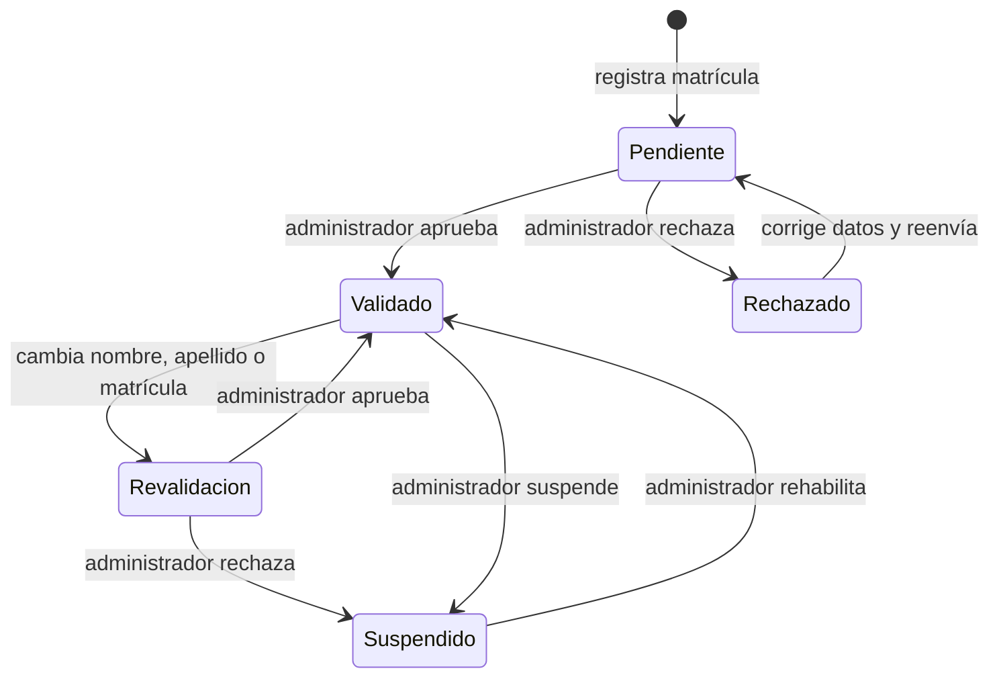
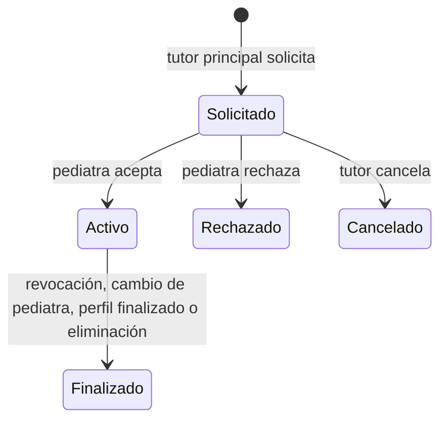

# 14 · Pediatras y vínculos (`PED`)

## Estados

### Perfil de pediatra

### Vínculo entre un niño y un pediatra

## Requerimientos funcionales

### RF-PED-01 · Perfil profesional
**Actores:** Pediatra · **Incremento:** I3 · **Sin conexión:** no

Datos del perfil de pediatra, además de los de la cuenta:

| Dato | Obligatorio | Observaciones |
|---|---|---|
| Especialidad | Sí | Por ahora solo "Pediatría" (D-04) |
| Jurisdicción de la matrícula | Sí | "Nacional" o una provincia (RN-PED-03) |
| Número de matrícula | Sí | |
| Compromiso de confidencialidad | Sí | Aceptación expresa (RNF-PRI-02) |

**Criterios de aceptación**
- **CA1.** Dados datos válidos y el compromiso aceptado, cuando el usuario envía el perfil,
  entonces queda *pendiente de validación* y ve un mensaje que explica que el equipo de Pasitos
  revisará su matrícula.
- **CA2.** Dada una combinación de jurisdicción y número ya registrada por otro pediatra, cuando
  el usuario envía el perfil, entonces se rechaza indicando que la matrícula ya está registrada y
  cómo contactar al equipo si cree que es un error.
- **CA3.** Dado un perfil pendiente, cuando el usuario entra en modo pediatra, entonces ve el
  estado de la validación y no accede a funciones profesionales (01 · Actores y permisos,
  sección 4).

### RF-PED-02 · Resultado de la validación
**Actores:** Pediatra, Sistema · **Incremento:** I3 · **Sin conexión:** no

**Criterios de aceptación**
- **CA1.** Dado un perfil aprobado por el administrador, cuando se registra la aprobación,
  entonces el pediatra recibe una notificación (N-12), aparece en la búsqueda y ve las
  solicitudes que estaban en espera.
- **CA2.** Dado un perfil rechazado, cuando se registra el rechazo, entonces el pediatra recibe
  una notificación con el motivo y puede corregir sus datos y reenviarlos.

### RF-PED-03 · Buscar un pediatra por matrícula
**Actores:** Tutor principal · **Incremento:** I3 · **Sin conexión:** no

**Criterios de aceptación**
- **CA1.** Dadas una jurisdicción y un número de matrícula de un pediatra validado, cuando el
  tutor busca, entonces ve nombre, apellido, jurisdicción y matrícula, y la opción de enviar la
  solicitud.
- **CA2.** Dada una matrícula que no corresponde a un pediatra validado, cuando el tutor busca,
  entonces se informa que no se encontró y se ofrece invitarlo a Pasitos (RF-PED-09). No se
  revela si existe un perfil pendiente o suspendido.
- **CA3.** Dado cualquier búsqueda, cuando se muestran resultados, entonces nunca se listan
  pediatras por nombre ni se ofrece un directorio (D-09).

### RF-PED-04 · Solicitar el vínculo
**Actores:** Tutor principal · **Incremento:** I3 · **Sin conexión:** no

**Criterios de aceptación**
- **CA1.** Dado un pediatra encontrado, cuando el tutor principal confirma la solicitud para un
  hijo, entonces el vínculo queda *solicitado* y el pediatra recibe una notificación (N-10).
- **CA2.** Dado un niño que ya tiene pediatra de cabecera, cuando el tutor solicita otro, entonces
  se le advierte que, si el nuevo acepta, el vínculo actual terminará (RF-PED-08), y debe
  confirmar.
- **CA3.** Dado un niño con una solicitud ya pendiente, cuando el tutor intenta enviar otra,
  entonces se le pide cancelar primero la pendiente (RN-PED-01).

### RF-PED-05 · Aceptar o rechazar una solicitud
**Actores:** Pediatra · **Incremento:** I3 · **Sin conexión:** no

**Criterios de aceptación**
- **CA1.** Dada una solicitud, cuando el pediatra la abre, entonces ve nombre, edad y sexo del
  niño y el nombre del tutor que la envió, y nada del historial hasta aceptar.
- **CA2.** Dada una solicitud, cuando el pediatra la acepta, entonces el vínculo pasa a *activo*,
  el niño aparece en su lista de pacientes y los tutores reciben una notificación (N-04).
- **CA3.** Dada una solicitud, cuando el pediatra la rechaza (con un motivo opcional), entonces
  los tutores reciben una notificación (N-04) y el niño queda sin cambios.
- **CA4.** Dada una solicitud sin respuesta, cuando pasan 15 días, entonces vence y el tutor
  principal recibe un aviso (RN-PED-06).

### RF-PED-06 · Cancelar una solicitud pendiente
**Actores:** Tutor principal · **Incremento:** I3 · **Sin conexión:** no

**Criterios de aceptación**
- **CA1.** Dada una solicitud pendiente, cuando el tutor principal la cancela, entonces
  desaparece de las solicitudes del pediatra.

### RF-PED-07 · Revocar el vínculo
**Actores:** Tutor principal · **Incremento:** I3 · **Sin conexión:** no

**Criterios de aceptación**
- **CA1.** Dado un vínculo activo, cuando el tutor principal lo revoca y confirma, entonces el
  vínculo pasa a *finalizado*, se aplica RN-PED-04 y el pediatra recibe una notificación (N-11).
- **CA2.** Dado un vínculo revocado, cuando el tutor ve el historial del niño, entonces todo lo
  que cargó el pediatra sigue ahí, identificado con su nombre.

### RF-PED-08 · Cambio de pediatra
**Actores:** Tutor principal, Pediatra · **Incremento:** I3 · **Sin conexión:** no

**Criterios de aceptación**
- **CA1.** Dado un niño con pediatra de cabecera y una solicitud a otro pediatra, cuando el nuevo
  la acepta, entonces el vínculo anterior pasa a *finalizado* en el mismo momento, se aplica
  RN-PED-04 al anterior y ambos pediatras y los tutores reciben una notificación.
- **CA2.** Dado el cambio, cuando el pediatra nuevo abre al paciente, entonces ve todo el
  historial según RN-PED-05.

### RF-PED-09 · Invitar a un pediatra no registrado
**Actores:** Tutor principal · **Incremento:** I3 · **Sin conexión:** no

**Criterios de aceptación**
- **CA1.** Dada una búsqueda sin resultado, cuando el tutor elige invitar y carga nombre,
  apellido y email del pediatra, entonces se envía un email de invitación a sumarse a Pasitos que
  menciona quién lo invita, y queda una solicitud *en espera de registro* para ese niño.
- **CA2.** Dada una invitación, cuando el invitado se registra como pediatra con ese email,
  entonces la solicitud se le asigna; la verá para aceptarla una vez validado (RF-PED-02).
- **CA3.** Dada una invitación sin registro, cuando pasan 15 días desde el envío, entonces vence,
  el tutor recibe un aviso y los datos del invitado se eliminan (RN-PED-07).
- **CA4.** Dada una invitación pendiente o vencida, cuando el tutor la reenvía, entonces se envía
  un email nuevo y empieza un plazo nuevo de 15 días (SUP-02).
- **CA5.** Dado que el invitado ya tiene cuenta como tutor con ese email, cuando recibe la
  invitación, entonces puede agregar el perfil de pediatra (RF-CTA-09).

### RF-PED-10 · Lista de pacientes
**Actores:** Pediatra · **Incremento:** I3 · **Sin conexión:** sí (lectura)

**Criterios de aceptación**
- **CA1.** Dado un pediatra validado, cuando abre Pacientes, entonces ve sus pacientes vinculados
  y propios con nombre, edad, fecha del último control y nivel del estado general.
- **CA2.** Dada la lista, cuando el pediatra filtra por "Con alertas", entonces ve solo los
  pacientes con estado "A controlar" o "Consultar con el pediatra", o con vacunas atrasadas.
- **CA3.** Dada la lista, cuando el pediatra busca por nombre, entonces la lista se filtra.
- **CA4.** Dado un paciente propio sin tutor, cuando aparece en la lista, entonces se distingue
  con la etiqueta "Sin tutor en la app".
- **CA5.** Dada la lista, cuando el pediatra abre "Consultas anteriores", entonces ve los
  pacientes con los que ya no tiene vínculo y solo puede abrir sus propias consultas (RN-PED-04).

### RF-PED-11 · Alta de un paciente propio
**Actores:** Pediatra · **Incremento:** I3 · **Sin conexión:** no

El pediatra da de alta a un paciente que no está en la app, con los mismos datos que RF-HIJ-01
(sin la declaración de representación). El pediatra queda como su pediatra de cabecera.

**Criterios de aceptación**
- **CA1.** Dados datos válidos, cuando el pediatra confirma, entonces el paciente aparece en su
  lista como "Sin tutor en la app".
- **CA2.** Dado un paciente propio, cuando el pediatra lo abre, entonces puede cargar
  mediciones, vacunas, eventos y hábitos, y hacer consultas, igual que con un paciente vinculado.

### RF-PED-12 · Invitar al tutor a reclamar el perfil
**Actores:** Pediatra, Tutor · **Incremento:** I3 · **Sin conexión:** no

**Criterios de aceptación**
- **CA1.** Dado un paciente propio sin tutor, cuando el pediatra ingresa el email del tutor y
  envía la invitación, entonces el tutor recibe una notificación (si tiene cuenta) y un email.
- **CA2.** Dada la invitación, cuando el tutor la acepta, entonces debe marcar la declaración de
  representación y elegir entre "Es un hijo nuevo en la app" o "Ya lo tengo cargado" (eligiendo
  cuál).
- **CA3.** Dado "Es un hijo nuevo", cuando el tutor confirma, entonces pasa a ser tutor principal
  del perfil y el vínculo con el pediatra queda activo.
- **CA4.** Dado "Ya lo tengo cargado", cuando el tutor confirma, entonces se ejecuta la
  unificación (RF-PED-13).
- **CA5.** Dada una invitación sin respuesta, cuando pasan 15 días, entonces vence y el pediatra
  puede reenviarla (SUP-03).

### RF-PED-13 · Unificar historiales
**Actores:** Tutor, Sistema · **Incremento:** I3 · **Sin conexión:** no

**Criterios de aceptación**
- **CA1.** Dados ambos perfiles, cuando el tutor elige unificar, entonces ve un resumen antes de
  confirmar: cuántas mediciones, vacunas y eventos se suman y qué pediatra quedará de cabecera
  (SUP-11).
- **CA2.** Dados perfiles con distinta fecha de nacimiento o sexo, cuando el tutor intenta
  unificar, entonces no se permite hasta que uno de los dos corrija el dato (RN-PED-09).
- **CA3.** Dada la confirmación, cuando se unifica, entonces queda un solo perfil (el del tutor)
  con todos los registros de ambos, cada uno con su autor, y el pediatra que invitó pasa a ser el
  de cabecera, reemplazando al anterior si lo había (RN-PED-10).
- **CA4.** Dados registros duplicados (por ejemplo, la misma dosis registrada en ambos perfiles),
  cuando se unifica, entonces se conserva el registro del pediatra y se descarta el otro.

### RF-PED-14 · Carga de datos por el pediatra
**Actores:** Pediatra de cabecera · **Incremento:** I3 · **Sin conexión:** no

El pediatra de cabecera puede cargar, editar y eliminar sus propias mediciones, vacunas, eventos
y hábitos sobre el niño, fuera de una consulta, con las mismas reglas que el tutor.

**Criterios de aceptación**
- **CA1.** Dado un registro cargado por el pediatra, cuando un tutor lo ve, entonces aparece
  identificado con el nombre del pediatra.
- **CA2.** Dado un registro cargado por un tutor, cuando el pediatra lo abre, entonces lo ve en
  modo lectura.

### RF-PED-15 · Historial de vínculos
**Actores:** Tutor · **Incremento:** I3 · **Sin conexión:** sí (lectura)

**Criterios de aceptación**
- **CA1.** Dado un niño, cuando el tutor abre "Pediatra", entonces ve el pediatra de cabecera, la
  solicitud o invitación pendiente si la hay, y el historial de pediatras anteriores con fecha de
  inicio y fin de cada vínculo.

## Reglas de negocio

| ID | Regla |
|---|---|
| RN-PED-01 | Un niño tiene como máximo **un vínculo activo** y como máximo **una solicitud o invitación pendiente** a la vez (D-13). |
| RN-PED-02 | Solo un pediatra **validado** aparece en la búsqueda, recibe solicitudes y da de alta pacientes. Si un pediatra validado cambia su nombre, apellido o matrícula, pasa a *pendiente de revalidación*: conserva sus vínculos y pacientes, pero no aparece en la búsqueda ni acepta solicitudes nuevas hasta que el administrador lo apruebe. |
| RN-PED-03 | La matrícula se identifica por jurisdicción (Nacional o una de las 24 jurisdicciones provinciales) y número. Esa combinación es única entre los perfiles de pediatra (D-19). |
| RN-PED-04 | **Fin de un vínculo** (por revocación, cambio de pediatra, eliminación del niño o perfil finalizado): el pediatra pierde todo acceso al niño. Conserva en modo lectura sus propias consultas, con nombre, apellido y fecha de nacimiento del niño como únicos datos. Todo lo que cargó permanece en el historial del niño con su autoría (D-20). |
| RN-PED-05 | El pediatra de cabecera ve todo el historial objetivo del niño (mediciones, vacunas, eventos, hábitos, hitos), incluido lo cargado antes del vínculo. De las consultas de otros pediatras ve solo fecha y profesional. Nunca ve observaciones ni indicaciones de otro pediatra (D-21). |
| RN-PED-06 | Las solicitudes de vínculo sin respuesta y las invitaciones a pediatras no registrados vencen a los 15 días del envío (D-15). |
| RN-PED-07 | El nombre, apellido y email de un pediatra invitado se usan solo para la invitación y se eliminan cuando vence sin registro. |
| RN-PED-08 | El pediatra puede eliminar un paciente propio mientras no tenga tutor. Una vez reclamado, el perfil pertenece al tutor y se rige por RN-HIJ-08. |
| RN-PED-09 | Solo se unifican perfiles con la misma fecha de nacimiento y el mismo sexo. Nombre, apellido, datos de nacimiento, alergias y antecedentes se toman del perfil del tutor (SUP-07). |
| RN-PED-10 | Al unificar, el pediatra que invitó al tutor pasa a ser el pediatra de cabecera. Si había otro, su vínculo termina según RN-PED-04 (D-22). |
| RN-PED-11 | Si el administrador suspende a un pediatra, sus vínculos activos terminan según RN-PED-04, los tutores reciben una notificación y pueden solicitar otro pediatra. Sus pacientes propios sin tutor quedan inaccesibles hasta que sea rehabilitado (SUP-06). |
