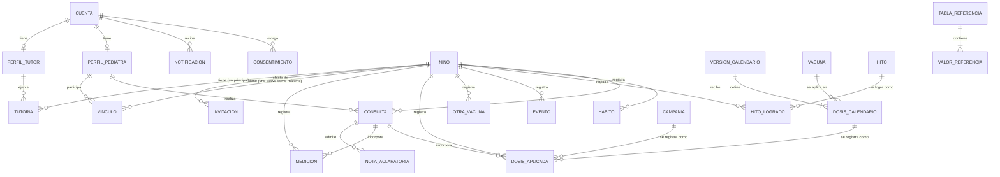

# 40 · Modelo conceptual

Entidades del dominio y sus relaciones. Es un modelo **conceptual**: no define tablas, tipos ni
claves. El modelo físico se decide en el diseño técnico y debe poder representar todo lo que
aparece aquí. En particular, el esquema actual de la base (`personas` como tabla única de tutores
e hijos, `usuarios`, `sesiones`) debe revisarse contra este modelo.

## Diagrama

## Entidades

| Entidad | Atributos principales | Notas |
|---|---|---|
| **Cuenta** | Nombre, apellido, email, método de acceso, estado del email, último modo usado | Una por persona. Puede tener perfil de tutor, de pediatra o ambos |
| **Consentimiento** | Tipo, versión, fecha y hora | Términos, declaración de representación, confidencialidad |
| **Perfil de tutor** | — | Se crea al registrarse como tutor |
| **Perfil de pediatra** | Especialidad, jurisdicción y número de matrícula, estado de validación, motivo de rechazo o suspensión | Jurisdicción + número es único |
| **Niño** | Nombre, apellido, sexo, fecha de nacimiento, semanas de gestación, medidas al nacer, alergias, antecedentes, avatar, estado (activo o finalizado) | Puede no tener tutores (paciente propio de un pediatra) |
| **Tutoría** | Rol (principal o secundario), fecha de inicio | Relación tutor–niño |
| **Invitación** | Tipo (a tutor, a pediatra no registrado, a reclamar un perfil), email, nombre (si aplica), estado, fecha de envío y de vencimiento | Los datos del invitado se eliminan al vencer |
| **Vínculo** | Estado (solicitado, activo, rechazado, cancelado, finalizado), fechas de solicitud, inicio y fin, motivo de fin | Relación niño–pediatra |
| **Medición** | Fecha, peso, longitud o talla, forma de medición, perímetro cefálico, valor atípico confirmado | Percentiles, puntaje Z y estado se calculan; no son datos cargados |
| **Vacuna** | Nombre, qué previene, fuente | Catálogo |
| **Versión de calendario** | Fecha de vigencia | Versionado del Calendario Nacional |
| **Dosis de calendario** | Vacuna, número de dosis, edad indicada, anticipación, tolerancia | |
| **Campaña** | Vacuna, rango de edad, fecha de inicio y fin | |
| **Dosis aplicada** | Fecha (puede faltar en carga retroactiva), lote, lugar | Referencia a una dosis de calendario o a una campaña |
| **Otra vacuna** | Nombre, fecha, lote, nota | Sin estado |
| **Consulta** | Fecha, tipo, acompañante, contenido de cada paso, indicaciones, observaciones, fecha del próximo control, estado (borrador o cerrada) | Las observaciones solo son visibles para su autor |
| **Nota aclaratoria** | Fecha, texto, visibilidad (privada o para la familia) | Solo en consultas cerradas |
| **Evento** | Tipo, subtipo, fecha, título, nota, ícono | Los automáticos se derivan de su registro de origen |
| **Hito** | Descripción, área, edad esperada, edad límite, fuente | Catálogo |
| **Hito logrado** | Fecha | |
| **Hábito** | Tipo (toma de pecho, biberón, pañal, sueño), fecha y hora, valores estimados | |
| **Consejo** | Título, cuerpo, categoría, edad desde y hasta, fuente, anticipatorio, estado | |
| **Tabla de referencia** | Indicador, origen (OMS o SAP), sexo, versión, vigente, validado por | |
| **Valor de referencia** | Edad, L, M, S o percentiles | |
| **Umbral** | Indicador, referencia, tramo de edad, nivel, límites, texto para tutores, clasificación técnica, validado por | Versionado |
| **Notificación** | Tipo, destinatario, fecha, leída, destino en la app | |
| **Registro de acceso** | Cuenta, fecha y hora, acción, tipo de dato, niño | No guarda valores de salud |
| **Administrador** | Nombre, email | Cuenta independiente de las cuentas de la app |

## Autoría

Toda medición, dosis aplicada, otra vacuna, evento manual, hito logrado y hábito registra **quién
lo cargó** (la cuenta) y **desde qué perfil** (tutor o pediatra), además de la fecha y hora de
carga. La autoría define quién puede editar el registro y cómo se muestra ("Familia" o el nombre
del profesional).
